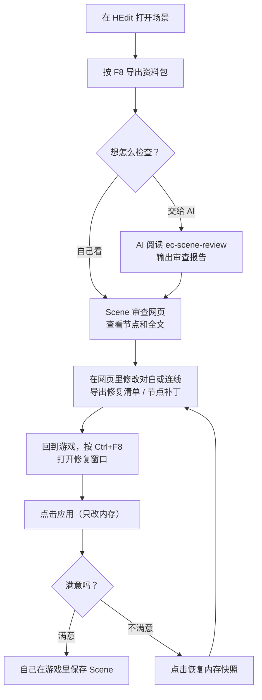
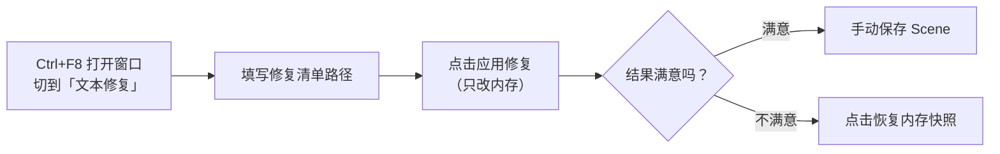

# EC_SceneAudit 玩家使用说明

EC_SceneAudit 是 Emotion Creators 的 BepInEx 插件，用来**检查和修补 HEdit 场景（Scene）**：

- 按一下 `F8`，把当前场景的节点、Part、CUT、对白和脚本整理成一份资料包；
- 把资料包交给 AI 或配套的「Scene 审查网页」，找出走不通的分支、写错的脚本、错字等问题；
- 把网页里改好的对白或连线带回游戏，**直接应用到当前仍存在的节点**，满意后由你自己保存。

插件不会自动保存你的 Scene 文件。改坏了可以一键恢复，只要你还没手动保存。

---

## 整体流程



---

## 安装

1. 确认游戏已装好 BepInEx。
2. 把 `EC_SceneAudit.dll` 放进 `BepInEx/plugins/` 下任意文件夹。
3. 启动游戏一次，会自动生成配置文件 `BepInEx/config/EC_SceneAudit.cfg`。

可选：如果需要在节点补丁里**扩大画布**，还要装支持动态扩展的 `EC_NodeSidePanel`。没装也能应用补丁，位置受游戏原生范围限制。

## 快捷键

| 按键 | 作用 | 在哪里能用 |
| --- | --- | --- |
| `F8` | 导出资料包 | HEdit 场景编辑 |
| `Ctrl+F8` | 显示 / 隐藏修复窗口 | 打开时只在 HEdit **节点总览**画面；窗口已显示时按一下即可隐藏 |

快捷键可以在配置文件里改。应用和恢复操作需要在节点总览执行；在 ADV/H 编辑、播放、加载或基础设置界面中无法使用。

---

## 第一步：按 F8 导出资料包

在 HEdit 中打开场景，按 `F8`。资料包保存在：

```text
UserData/PluginData/SceneAudit/<场景标题>/<日期>/<批次目录>/
```

每按一次就生成一个新的批次目录，不会覆盖之前的导出。场景没有标题时用日期代替。

一个批次目录里主要有：

| 文件 | 内容 |
| --- | --- |
| `scene.json` | 完整资料：全部节点、连线、Part、CUT、对白原文、脚本 |
| `ai-summary.json` | 给 AI 看的精简摘要：统计、变量读写、跳转关系、出口缺失提示，不含对白全文 |
| 外部脚本副本 | 场景实际引用到的外部脚本文件 |
| `bundle.json` / `bundle.sha256` | 文件清单和校验码，用来确认资料包完整、没被改动 |

注意：

- 整个批次目录可以随意移动或拷给别人，不依赖游戏所在盘符。
- 缺少 `bundle.sha256` 的目录说明导出中途失败了，这份不算完整资料包，请重新按 F8。
- 导出过程**只读取**场景，不会执行脚本，也不会改动任何节点、对白或变量。

---

## 第二步：检查问题

### 方式一：交给 AI 审查

把插件附带的 `ec-scene-review` 整个文件夹，加上这次 F8 的整个批次目录，一起交给 AI，然后说：

> 请先阅读 `ec-scene-review/SKILL.md`，按其中流程审查我提供的导出文件，说明问题位置、触发条件、证据和未验证范围。

AI 会给出简短说明和一份 `review-report.json` 审查报告。

### 方式二：用 Scene 审查网页查看

双击 `scene-review.exe`，在浏览器里打开资料包（以及 AI 的报告），就能看到节点图、问题标记和每个 CUT 的全文。网页也能直接编辑对白和连线。

详细用法见 [Scene 审查网页使用说明](review-browser/Readme-claude-opus-5.5.md)。

---

## 第三步：把修改带回游戏

网页能导出两种文件，回到游戏后在同一个修复窗口（`Ctrl+F8`）里使用，窗口顶部有两个页签：

| 文件 | 页签 | 能改什么 | 不能改什么 |
| --- | --- | --- | --- |
| 修复清单 `ec-scene-repair-plan.json` | 文本修复 | 对白框里的文字（包括其中的 `<script>`） | 节点、Part 结构 |
| 节点补丁 `ec-scene-node-patch` | 节点补丁 | 已有连线或可用空出口槽指向哪个节点、把已有连接设为空槽、节点摆放位置 | 不增删节点和选项 |

两个页签各自保存最近一次应用前的快照，互不影响，可以分别应用和恢复。

### 修复对白（修复清单）



1. **按 `Ctrl+F8`** 打开修复窗口，切到「文本修复」页，填写修复清单路径。
   路径也可以提前写在配置文件 `Repair` 段的 `Plan Path` 里，点击应用时会记住当前填写的路径。
2. **点「应用修复」**。插件按节点 UID、CUT / 文本框源序号和布局序号定位当前目标：
   - 找得到的项直接写入新文本，**不比较当前原文**，所以你在导出后改过的台词也会被覆盖；
   - 找不到的节点、CUT 或文本框直接跳过，不影响其它项；
   - 只有整个文件读不懂时才报错，错误信息显示在窗口里。
3. 窗口显示「已应用 N 项，未保存」，并逐项列出「已应用 / 未应用」。应用前会自动给涉及的 Part、节点和相关连线拍一份内存快照。
4. **需要保留结果时，在游戏里手动保存 Scene。** 插件不会写 Scene 文件。

不需要原 F8 资料包目录，也没有预检和回验步骤。再次应用有任何写入时，快照会更新为本次应用前的状态。

### 修改连线和布局（节点补丁）

步骤和修复对白一样，切到「节点补丁」页：

1. 填写节点补丁路径（配置项 `Node Patch Path`）。
2. 点「应用节点补丁」。
3. 匹配到的节点位置和来源槽连接会写入；缺失来源节点、目标节点或槽位直接跳过。已移动的节点、变化的旧连接以及补丁外新增的节点，都不会阻止其它修改。
4. 插件不增删节点或选项，连接可改目标、可设回空槽，不覆盖当前条件参数。

需要更大画布时，装有 `EC_NodeSidePanel` 会自动扩展；没有该能力时仍然应用节点，位置由游戏原生范围限制。恢复快照不会缩小已经扩大的画布。

---

## 隐藏、重开与重复恢复

- 点「隐藏」或按 `Ctrl+F8` 只隐藏窗口，快照继续保留。
- 再按 `Ctrl+F8` 可以重新打开。窗口里能看到当前页快照的规模，例如「3 个 Part，5 条相关连线」。
- 点「恢复内存快照」把当前页涉及的目标还原到应用前，**恢复成功后快照仍然可用，可以反复恢复**。
- 恢复时已经删除的节点、Part 或连线端点会跳过，不会重新创建。其余失败原因显示在窗口里。
- 新应用不会被旧快照阻止；没有匹配项或文件读取失败时，保留原来可用的快照。
- **切换 Scene 或重新加载后**，旧快照不能用于新 Scene，窗口会明确提示。

快捷键配置键仍叫 `Config/Repair Preflight`，只是名称沿用，旧配置无须调整。`Repair/Bundle Directory` 也保留兼容，但不再参与应用。

---

## 安全说明

| 你担心的 | 实际情况 |
| --- | --- |
| 会不会自动保存覆盖我的 Scene？ | 不会。所有修改只在内存里，保存由你决定 |
| 改坏了怎么办？ | 没保存前点「恢复内存快照」即可回到修改前，恢复后可再次恢复 |
| 某一项写入出错会怎样？ | 该项立刻撤回，其它已写入的项保留；窗口显示失败原因 |
| 部分清单项找不到？ | 跳过该项，其余项照常应用，不会被整份拒绝 |
| 导出会不会改动场景？ | 不会。导出只读取 |
| 会不会执行脚本？ | 不会。插件只读取脚本文字，不运行 |

需要留意：

- **切换场景或重新加载**后，旧的快照就失效了，无法再恢复。
- 应用只改内存。没有手动保存就结束游戏，改动会丢失。
- 应用成功不代表改后的脚本一定按你预期运行，请在游戏里实际试玩确认后再保存。

---

## 常见问题

**按 Ctrl+F8 没反应？**
打开窗口需要停留在 HEdit 节点总览。窗口已经显示时，`Ctrl+F8` 只负责隐藏。ADV/H 编辑、播放、加载和基础设置界面都不能打开。

**应用后提示「请回到 HEdit 节点总览」？**
应用和恢复都要求当前处于节点总览，回到总览再点一次即可。

**应用后游戏里没变化？**
检查窗口状态：如果显示「没有匹配的文本项」，说明清单里的目标在当前 Scene 中都不存在。如果显示「已应用 N 项，未保存」，改动已经在内存里，保存 Scene 后才会写入文件。

**清单里的某些项没生效？**
该项在当前 Scene 中找不到，被跳过了。插件会列出每项的「已应用 / 未应用」状态，可以回网页核对节点、CUT 和文本框序号。

**恢复时提示「Scene 已切换或重新加载」？**
快照只对应用时的那份 Scene 有效。重新加载后无法恢复，请用保存前的文件备份。

**外部脚本没有被识别？**
游戏要求外部脚本文件里自己带有小写的 `<script>…</script>`，否则当作普通文字处理。插件和网页都按这个规则处理，不会替你补上。

**为什么有的 Part 有出口却没连到下一个节点？**
ADV Part 播到最后 CUT 时，只有当前选项对应的出口会被用到；没有脚本跳转时，这些出口必须接上目标。导出会列出这类 Part 和空着的出口编号。

**空出口能不能在网页里补上？**
可以。选中节点后，节点补丁面板会列出可用的空出口，选一个目标即可，导出的补丁带回游戏应用。

**有大小限制吗？**
导出时单个文件最多 2 MiB、合计 16 MiB、最多 256 个文件。修复清单文件最多 64 MiB，最多 1000 项，每项新文字最多 100 万字符。
