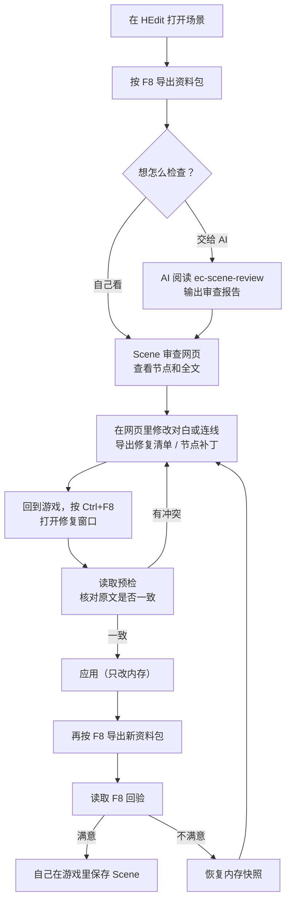
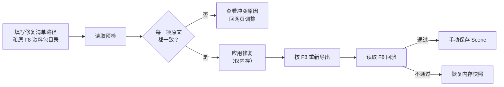

# EC_SceneAudit 玩家使用说明

EC_SceneAudit 是 Emotion Creators 的 BepInEx 插件，用来**检查和修补 HEdit 场景（Scene）**：

- 按一下 `F8`，把当前场景的节点、Part、CUT、对白和脚本整理成一份资料包；
- 把资料包交给 AI 或配套的「Scene 审查网页」，找出走不通的分支、写错的脚本、错字等问题；
- 把网页里改好的对白或连线带回游戏，**先核对、再写入内存**，满意后由你自己保存。

插件不会自动保存你的 Scene 文件。改坏了可以一键恢复，只要你还没手动保存。

---

## 整体流程



---

## 安装

1. 确认游戏已装好 BepInEx。
2. 把 `EC_SceneAudit.dll` 放进 `BepInEx/plugins/` 下任意文件夹。
3. 启动游戏一次，会自动生成配置文件 `BepInEx/config/EC_SceneAudit.cfg`。

可选：如果需要在节点补丁里**扩大画布**，还要装支持动态扩展的 `EC_NodeSidePanel`。没装也能用其它功能。

## 快捷键

| 按键 | 作用 | 在哪里能用 |
| --- | --- | --- |
| `F8` | 导出资料包 | HEdit 场景编辑 |
| `Ctrl+F8` | 打开修复窗口 | 只在 HEdit **节点总览**画面 |

快捷键可以在配置文件里改。修复窗口在 ADV/H 编辑、播放、加载或基础设置界面中无法使用。

---

## 第一步：按 F8 导出资料包

在 HEdit 中打开场景，按 `F8`。资料包保存在：

```text
UserData/PluginData/SceneAudit/<场景标题>/<日期>/<批次目录>/
```

每按一次就生成一个新的批次目录，不会覆盖之前的导出。场景没有标题时用日期代替。

一个批次目录里主要有：

| 文件 | 内容 |
| --- | --- |
| `scene.json` | 完整资料：全部节点、连线、Part、CUT、对白原文、脚本 |
| `ai-summary.json` | 给 AI 看的精简摘要：统计、变量读写、跳转关系，不含对白全文 |
| 外部脚本副本 | 场景实际引用到的外部脚本文件 |
| `bundle.json` / `bundle.sha256` | 文件清单和校验码，用来确认资料包完整、没被改动 |

注意：

- 整个批次目录可以随意移动或拷给别人，不依赖游戏所在盘符。
- 缺少 `bundle.sha256` 的目录说明导出中途失败了，这份不算完整资料包，请重新按 F8。
- 导出过程**只读取**场景，不会执行脚本，也不会改动任何节点、对白或变量。

---

## 第二步：检查问题

### 方式一：交给 AI 审查

把插件附带的 `ec-scene-review` 整个文件夹，加上这次 F8 的整个批次目录，一起交给 AI，然后说：

> 请先阅读 `ec-scene-review/SKILL.md`，按其中流程审查我提供的导出文件，说明问题位置、触发条件、证据和未验证范围。

AI 会给出简短说明和一份 `review-report.json` 审查报告。

### 方式二：用 Scene 审查网页查看

双击 `scene-review.exe`，在浏览器里打开资料包（以及 AI 的报告），就能看到节点图、问题标记和每个 CUT 的全文。网页也能直接编辑对白和连线。

详细用法见 [Scene 审查网页使用说明](review-browser/Readme-claude-opus-5.5.md)。

---

## 第三步：把修改带回游戏

网页能导出两种文件，回到游戏后在同一个修复窗口（`Ctrl+F8`）里使用：

| 文件 | 能改什么 | 不能改什么 |
| --- | --- | --- |
| 修复清单 `ec-scene-repair-plan.json` | 对白框里的文字（包括其中的 `<script>`） | 节点、Part 结构 |
| 节点补丁 `ec-scene-node-patch` | 已有连线指向哪个节点、节点摆放位置 | 不增删节点和选项 |

两种修改不能同时处于「待恢复」状态，请先处理完一种再做另一种。

### 修复对白（修复清单）



1. **按 `Ctrl+F8`** 打开修复窗口，填写「修复清单」路径和它对应的那份 F8 资料包目录。
   这两个路径也可以提前写在配置文件 `Repair` 段的 `Plan Path`、`Bundle Directory` 里。
2. **点「读取预检」**。窗口逐项列出每处修改的位置，结论只有两种：
   - 「原文一致」：游戏里当前的文字和资料包里一样，可以改；
   - 「冲突」：说明这段文字已经变了，或者清单和资料包对不上。
   可以点「导出文字报告」，在清单旁边生成一份 `*.preflight-<时间>.txt` 存档。预检本身什么都不改。
3. **点「应用修复（仅内存）」**。插件会再核对一遍，**任何一项不对就整批都不改**。改之前会自动给涉及的内容拍一份快照。
4. 应用成功后状态显示「已应用，未保存，待 F8 回验」。**再按一次 `F8`**，然后在窗口里点「读取 F8 回验」，确认新文字已经生效、其它地方没被误改。
5. 结果满意 → 在游戏里自己保存 Scene。不满意 → 点「恢复内存快照」，回到修改前的样子。

### 修改连线和布局（节点补丁）

步骤和修复对白一样，只是按钮名称不同：

1. 填写节点补丁路径和原 F8 资料包目录（配置项 `Node Patch Path`）。
2. 「读取节点预检」→「应用节点补丁（仅内存）」。
3. 按 `F8` 重新导出 →「读取节点 F8 回验」。
4. 满意就手动保存；不满意就恢复节点快照。

如果补丁需要扩大画布，窗口会再问你一次。只有装了支持扩展的 `EC_NodeSidePanel` 才能扩大，否则整批拒绝。恢复节点快照时，已经扩大的画布会保留。

---

## 安全说明

| 你担心的 | 实际情况 |
| --- | --- |
| 会不会自动保存覆盖我的 Scene？ | 不会。所有修改只在内存里，保存由你决定 |
| 改坏了怎么办？ | 没保存前点「恢复内存快照」即可回到修改前 |
| 改一半出错会怎样？ | 整批撤销，不会留下改了一半的状态 |
| 导出会不会改动场景？ | 不会。导出和预检都只读取 |
| 会不会执行脚本？ | 不会。插件只读取脚本文字，不运行 |

需要留意：

- **切换场景或重新加载**后，旧的快照就失效了，无法再恢复。
- 「清除本次记录」只是丢掉快照，**已经写进内存的修改还在**。
- 预检通过只代表「原文对得上」，不代表修改后的脚本一定按你预期运行。请回验后再实际试玩一遍。

---

## 常见问题

**按 Ctrl+F8 没反应？**
修复窗口只在 HEdit 节点总览画面能打开。离开总览、重开窗口或修改路径后，旧的检查结果会被清除，需要重新读取。

**预检提示冲突？**
通常是游戏里的场景在导出之后又被改过，或者填的资料包不是导出修复清单时用的那一份。请重新 F8，再用新资料包在网页里重做修改。

**回验时提示资料包不对？**
回验只接受「应用修复之后」新导出的资料包。请在应用后重新按 F8，再读取那份新的。

**外部脚本没有被识别？**
游戏要求外部脚本文件里自己带有小写的 `<script>…</script>`，否则当作普通文字处理。插件和网页都按这个规则处理，不会替你补上。

**有大小限制吗？**
导出时单个文件最多 2 MiB、合计 16 MiB、最多 256 个文件。修复清单最多 1000 项，每项新文字最多 100 万字符。
