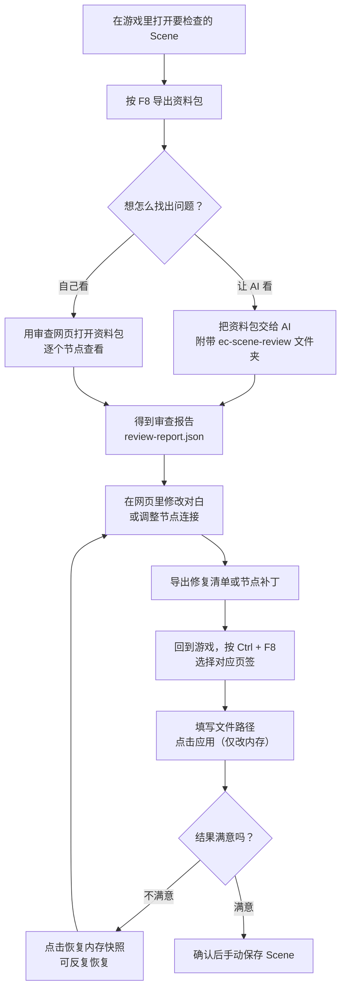
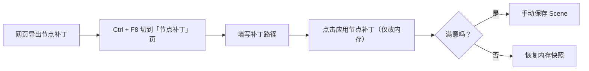

# EC Scene Audit 玩家使用说明

给 Emotion Creators 的 Scene 做一次“体检”：把节点、对白和脚本导出成只读资料，交给 AI 或网页工具找出可能卡关、跳错分支的地方；确认之后，再在游戏里直接应用对白和连线的修改。

整个过程中，插件不会自动保存 Scene，也不会执行 Scene 里的脚本。应用只改内存，改坏了可以一键恢复。

## 它能帮你做什么

- 导出一份完整的 Scene “证据包”，包含节点、Part、CUT、对白原文和脚本。
- 配合 AI 或审查网页，找出流程走不通、跳转目标错误、变量条件异常等问题。
- 对确认过的对白做文字修复，找到当前目标就写入；应用只改游戏内存，随时可以恢复。
- 调整已有节点之间的连接和摆放位置，但不会增删节点、选项或输出槽。

## 它由三个部分组成

| 部分 | 作用 | 怎么用 |
|---|---|---|
| 游戏插件 `EC_SceneAudit.dll` | 导出资料，在游戏内应用修复并保留内存快照 | 放进 `BepInEx/plugins/` |
| 审查网页 `scene-review.exe` | 浏览节点与对白、写标注、编辑修复 | 双击后浏览器打开 |
| AI 审查包 `ec-scene-review` | 让 AI 按固定流程分析脚本 | 整个文件夹交给 AI |

三部分互相独立。只用插件也能导出资料；只用网页也能阅读和编辑；AI 审查是可选的。

## 开始前准备

1. 游戏已经安装好 BepInEx 5（64 位），其他插件能正常加载。
2. 把 `EC_SceneAudit.dll` 放进游戏的 `BepInEx/plugins/` 目录，可以放在子文件夹里。
3. 启动游戏，进入 Scene 编辑界面的节点总览。BepInEx 控制台出现类似 `EC Scene Audit v1.3.0 loaded` 的提示，就表示加载成功。
4. 修改前建议先备份要动的 Scene，或者至少先在游戏里手动保存一次。插件不会替你保存。

启动日志里会同时打印当前的两个快捷键。默认是：

- `F8`：导出资料
- `Ctrl + F8`：显示或隐藏修复窗口

快捷键可以在 `BepInEx/config/EC_SceneAudit.cfg` 的 `Config` 段修改。

## 完整流程



## 第一步：导出资料（F8）

1. 在 HEdit 里打开要检查的 Scene。
2. 按 `F8`。
3. 看 BepInEx 控制台，出现 `Scene audit exported: ...` 就表示导出成功，后面会跟着节点、Part、CUT、对白数量和警告数。
4. 到下面的目录找到这次导出的批次文件夹：

```text
UserData/PluginData/SceneAudit/{Scene标题}/{yyyyMMdd}/{批次目录}/
```

- Scene 标题为空时，文件夹名会用导出日期。
- 每次按 F8 都会生成一个新批次，不会覆盖上一次的摘要。
- 一个重要提醒：交给 AI 或网页时，请提供**整个批次目录**，不要只拿其中的 `scene.json`。

一个完整批次大致长这样：

```text
批次目录/
├── bundle.json          这一次导出的来源清单
├── bundle.sha256        校验文件
├── scene.json           完整证据
├── ai-summary.json      给 AI 的精简摘要
└── dependencies/        本次实际引用到的外部脚本
```

导出是只读操作：不会改节点、对白、变量，也不会执行脚本。读取失败的项会写进警告，不会用猜测补齐。

## 第二步：找出问题

有两条路，选一条或两条都用。

### 路线 A：让 AI 审查

1. 把 `ec-scene-review` **整个文件夹**准备好。
2. 把本次 F8 的整个批次目录也准备好。
3. 对 AI 说：

> 请先阅读 `ec-scene-review/SKILL.md`，按其中流程审查我提供的导出文件，说明问题位置、触发条件、证据和未验证范围。

AI 会输出一段简短说明和一份 `review-report.json`。报告里的问题位置、触发条件和证据都可以回到资料包里核对。

AI 审查是静态分析，不等于实际通关。它不会执行脚本，也不能保证所有路线都能玩。

### 路线 B：用审查网页自己看

双击 `scene-review.exe`，按另一个说明文档打开网页，选择本次资料目录，就可以逐个节点、逐句对白地查看，并直接编辑修复草稿。详见 [review-browser 玩家说明](review-browser/readme-deepseek-v4.1-flash.md)。

没有审查报告也能做修复；报告只是帮你更快定位问题。

## 第三步：应用修复（Ctrl + F8，只改内存）

1. 回到游戏，确保当前在 HEdit 的**节点总览**界面。
2. 按 `Ctrl + F8` 打开修复窗口，默认停在“文本修复”页。
3. 填写网页导出的修复清单路径 `ec-scene-repair-plan.json`。
   路径可以在配置文件 `Repair` 段的 `Plan Path` 里预填，点击应用时会记住当前填写的路径。
4. 点击“应用修复”。

插件按节点 UID、CUT / 文本框源序号和布局序号定位当前目标：

- 找得到的项直接写入新文本，**不比较当前原文**。导出后你又改过台词，也会被清单里的新文覆盖。
- 找不到的节点、CUT 或文本框直接跳过，不会取消其它项。
- 只有文件本身读不懂时才报错；错误信息会显示在窗口里。

应用前会给涉及的 Part、节点和相关连线拍一份内存快照。窗口会显示“已应用 N 项，未保存”，并逐项列出“已应用 / 未应用”。

这一步不需要填写原 F8 资料目录，也没有预检和回验。插件不会写 Scene 文件，也不会调用游戏的全量保存或读档。

此时改动只在内存里。如果你不继续操作，游戏进程结束时改动就没了；如果你手动保存 Scene，改动才会真正写入文件。

## 第四步：节点补丁（可选）

除了改对白，也可以调整已有节点之间的连接和节点位置。



规则和文字修复类似：

- 窗口里填写网页导出的节点补丁路径；
- 点击“应用节点补丁”；
- 匹配到的节点位置和来源槽连接会写入，缺失来源节点、目标节点或槽位直接跳过；
- 已移动的节点、变化的旧连接以及补丁外新增的节点，都不会阻止其它修改；
- 可修改已有连接的目标，也可给可用空出口槽指定目标，或把已有连接设回空槽；不增删节点、选项或输出槽；
- 不自动保存 Scene。

画布扩展在装有支持动态扩展的 `EC_NodeSidePanel` 时自动进行；没有该能力也能应用，位置由游戏原生范围限制。恢复节点快照不会取消已经扩大的画布。

文字修复和节点补丁各自保留最近一次应用前的快照，两个页签互不影响。

## 想撤销怎么办

- **恢复内存快照**：把当前页涉及的目标、节点和连线恢复到应用前。未涉及的节点保持原样。
- 恢复成功后快照仍然保留，可以反复点击。已删除的节点或连线端点会跳过，不会重新创建。
- 新应用不会被旧快照阻止；没有匹配项或读文件失败时，原来可用的快照会保留。
- 切换 Scene，或者在同一路径重新加载 Scene 后，旧快照会失效，不能再恢复。
- 应用和恢复都需要停留在节点总览界面。

## 安全边界

- F8 导出是只读操作，不会执行脚本。
- “应用修复”和“应用节点补丁”只改游戏内存，不写 Scene 文件。
- 最终是否保存 Scene，始终由你自己决定。
- 单项写入失败只撤回该项，其它已写入的项保留。
- 插件不修改外部脚本文件，也不会自动读取同目录无关的脚本。
- 资料包的缺失项、解析失败项和读取失败项会记录为警告，不会靠猜测补全。

## 常见问题

**按 F8 没反应？**

确认当前确实在 HEdit Scene 里。F8 被其他插件占用时，可以在 `EC_SceneAudit.cfg` 里改键。

**Ctrl + F8 没反应？**

打开窗口需要停在 HEdit 的节点总览里。其他编辑界面、播放和加载界面都不响应。窗口已经显示时，`Ctrl + F8` 只负责隐藏。

**提示“请回到 HEdit 节点总览”？**

应用和恢复都要求当前处于节点总览，回到总览再点一次即可。

**找不到导出的资料？**

看 BepInEx 控制台里的 `Scene audit exported:` 路径，或者到 `UserData/PluginData/SceneAudit/` 下按 Scene 标题和日期查找。

**应用后游戏里没变化？**

改动只在内存里。先看窗口状态：如果显示“没有匹配的文本项”，说明清单里的目标在当前 Scene 中都不存在；如果显示“已应用 N 项，未保存”，请在游戏里手动保存 Scene。

**清单里的某些项没生效？**

该项在当前 Scene 中找不到，被跳过了。窗口里每项都有“已应用 / 未应用”状态，可以回网页核对节点、CUT 和文本框序号。

**恢复时提示“Scene 已切换或重新加载”？**

快照只对应用时的那份 Scene 有效。重新加载后无法恢复，请使用保存前的文件备份。

**有些 Part 有出口槽却没连下一个节点，为什么没提示？**

ADV Part 播到最后 CUT 时只用当前选项对应的出口。没有脚本跳转时这些出口必须接上目标，导出会把这类 Part 和空着的出口编号列进 `ai-summary.json`。

**能不能在网页里补上空出口？**

可以。选中节点后，节点补丁面板列出可用的空出口，选目标后导出补丁，回游戏应用即可。

**切换过 Scene，还能恢复吗？**

不能。快照只对当前加载的 Scene 和当前会话有效。

**修复清单能改什么？**

只能替换已有对白框的文本布局内容，包括其中的内嵌脚本。不能增删节点、选项或输出槽，也不能修改外部脚本文件。修改后的脚本是否有效，需要你自己确认。

## 文件位置速查

| 内容 | 位置 |
|---|---|
| 插件配置 | `BepInEx/config/EC_SceneAudit.cfg` |
| F8 资料包 | `UserData/PluginData/SceneAudit/{Scene标题}/{yyyyMMdd}/{批次目录}/` |
| 修复清单 | 网页导出，默认文件名 `ec-scene-repair-plan.json` |
| 节点补丁 | 网页导出的 `ec-scene-node-patch` 文件 |
| 插件日志 | BepInEx 控制台窗口和游戏日志 |
