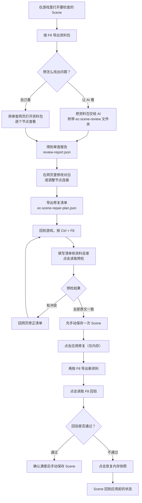
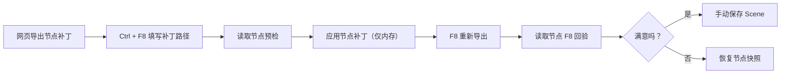

# EC Scene Audit 玩家使用说明

给 Emotion Creators 的 Scene 做一次“体检”：把节点、对白和脚本导出成只读资料，交给 AI 或网页工具找出可能卡关、跳错分支的地方；确认之后，再在游戏里安全地修改对白。

整个过程中，插件不会自动保存 Scene，也不会执行 Scene 里的脚本。

## 它能帮你做什么

- 导出一份完整的 Scene “证据包”，包含节点、Part、CUT、对白原文和脚本。
- 配合 AI 或审查网页，找出流程走不通、跳转目标错误、变量条件异常等问题。
- 对确认过的对白做文字修复，先预检再应用；应用只改游戏内存，随时可以恢复。
- 调整已有节点之间的连接和摆放位置，但不会增删节点、选项或输出槽。

## 它由三个部分组成

| 部分 | 作用 | 怎么用 |
|---|---|---|
| 游戏插件 `EC_SceneAudit.dll` | 导出资料、游戏内预检与写回内存 | 放进 `BepInEx/plugins/` |
| 审查网页 `scene-review.exe` | 浏览节点与对白、写标注、编辑修复 | 双击后浏览器打开 |
| AI 审查包 `ec-scene-review` | 让 AI 按固定流程分析脚本 | 整个文件夹交给 AI |

三部分互相独立。只用插件也能导出资料；只用网页也能阅读和编辑；AI 审查是可选的。

## 开始前准备

1. 游戏已经安装好 BepInEx 5（64 位），其他插件能正常加载。
2. 把 `EC_SceneAudit.dll` 放进游戏的 `BepInEx/plugins/` 目录，可以放在子文件夹里。
3. 启动游戏，进入 Scene 编辑界面的节点总览。BepInEx 控制台出现类似 `EC Scene Audit v1.1.0 loaded` 的提示，就表示加载成功。
4. 修改前建议先备份要动的 Scene，或者至少先在游戏里手动保存一次。

启动日志里会同时打印当前的两个快捷键。默认是：

- `F8`：导出资料
- `Ctrl + F8`：打开修复预检窗口

快捷键可以在 `BepInEx/config/EC_SceneAudit.cfg` 的 `Config` 段修改。

## 完整流程



## 第一步：导出资料（F8）

1. 在 HEdit 里打开要检查的 Scene。
2. 按 `F8`。
3. 看 BepInEx 控制台，出现 `Scene audit exported: ...` 就表示导出成功，后面会跟着节点、Part、CUT、对白数量和警告数。
4. 到下面的目录找到这次导出的批次文件夹：

```text
UserData/PluginData/SceneAudit/{Scene标题}/{yyyyMMdd}/{批次目录}/
```

- Scene 标题为空时，文件夹名会用导出日期。
- 每次按 F8 都会生成一个新批次，不会覆盖上一次的摘要。
- 一个重要提醒：交给 AI 或网页时，请提供**整个批次目录**，不要只拿其中的 `scene.json`。

一个完整批次大致长这样：

```text
批次目录/
├── bundle.json          这一次导出的来源清单
├── bundle.sha256        校验文件
├── scene.json           完整证据
├── ai-summary.json      给 AI 的精简摘要
└── dependencies/        本次实际引用到的外部脚本
```

导出是只读操作：不会改节点、对白、变量，也不会执行脚本。读取失败的项会写进警告，不会用猜测补齐。

## 第二步：找出问题

有两条路，选一条或两条都用。

### 路线 A：让 AI 审查

1. 把 `ec-scene-review` **整个文件夹**准备好。
2. 把本次 F8 的整个批次目录也准备好。
3. 对 AI 说：

> 请先阅读 `ec-scene-review/SKILL.md`，按其中流程审查我提供的导出文件，说明问题位置、触发条件、证据和未验证范围。

AI 会输出一段简短说明和一份 `review-report.json`。报告里的问题位置、触发条件和证据都可以回到资料包里核对。

AI 审查是静态分析，不等于实际通关。它不会执行脚本，也不能保证所有路线都能玩。

### 路线 B：用审查网页自己看

双击 `scene-review.exe`，按另一个说明文档打开网页，选择本次资料目录，就可以逐个节点、逐句对白地查看，并直接编辑修复草稿。详见 [review-browser 玩家说明](review-browser/readme-deepseek-v4.1-flash.md)。

没有审查报告也能做修复；报告只是帮你更快定位问题。

## 第三步：修复预检（Ctrl + F8，只读）

这一步只检查“清单对不对”，不会改任何文本。

1. 回到游戏，确保当前在 HEdit 的**节点总览**界面。
2. 按 `Ctrl + F8` 打开修复窗口。
3. 填写两个路径：
   - 修复清单：网页导出的 `ec-scene-repair-plan.json`
   - 资料目录：这份清单对应的 F8 批次目录
4. 点击“读取预检”。

路径可以在配置文件 `Repair` 段的 `Plan Path` 和 `Bundle Directory` 里预填。点击读取时会记住当前填写的路径。

预检结果会逐项显示 Part、CUT、文本框、布局位置，以及“原文一致”或“冲突”。它只比较原文和位置，不执行修改稿，也不证明改完后的脚本一定能运行。

如果出现冲突，常见原因是：

- 清单和资料不是同一批 F8；
- 清单导出后，游戏里的 Scene 又被改过；
- 资料目录选错，或者被移动、替换过。

需要留档时，可以点“导出文字报告”，会在清单同目录生成一个新的 `*.preflight-<时间>.txt`，不会改清单，也不会改 F8 资料。

注意：

- 预检只在节点总览里可用。ADV/HPart 编辑、播放、加载和基础设置界面都不行。
- 离开总览、重新打开窗口或修改路径，旧的预检结果会被清除。

## 第四步：应用修复（只改内存）

预检全部通过后，才建议继续。

1. **先在游戏里手动保存一次 Scene。** 这是你出事时的退路。
2. 点击“应用修复（仅内存）”。
3. 插件会重新读取清单和资料包，并重新核验当前 Scene。来源、结构、UID、源序号或原文任何一项对不上，都不会写回，内存保持原样。
4. 写回只修改清单指定的对白文本布局，整批作为一次操作；任意一项定位失败或写入异常，本次改动全部撤销。

插件不会写 Scene 文件，也不会调用游戏的全量保存或读档。应用成功后，窗口会显示“已应用，未保存，待 F8 回验”。

此时改动只在内存里。如果你不继续操作，游戏进程结束时改动就没了；如果你手动保存 Scene，改动才会真正写入文件。

## 第五步：F8 回验

1. 不要再改别的内容，直接按 `F8` 导出新资料。
2. 回到修复窗口，点击“读取 F8 回验”。
3. 插件会逐项检查：
   - 每一项的新文本是否已经是当前文本；
   - 旧原文是否已经不在当前位置；
   - 没有被修改的项目，结构和文本是否保持原样。

回验只接受本次会话、应用之后导出的新批次。

- **回验通过**：确认结果满意后，自己在游戏里手动保存 Scene。
- **回验不通过**：不要急着保存。保留当前内存结果和快照，点击“恢复内存快照”。恢复只在节点总览内执行，会先校验全部目标和连线端点；失败时会尽量回滚并如实告诉你结果。

## 节点补丁（可选）

除了改对白，也可以调整已有节点之间的连接和节点位置。



规则和文字修复类似：

- 窗口里填写网页导出的节点补丁路径，以及原始 F8 资料目录；
- 依次点击“读取节点预检”“应用节点补丁（仅内存）”；
- 只修改已有连接的目标和补丁里的节点位置，不增删节点、选项或输出槽；
- 不自动保存 Scene；
- 应用后重新按 F8，再点“读取节点 F8 回验”；不满意就恢复节点快照。

画布扩展有额外条件：只有安装了支持动态扩展 API 的 `EC_NodeSidePanel` 才能扩大画布；当前环境不支持时，整批补丁会被拒绝。扩展属于本次会话状态，恢复节点快照不会取消已经扩大的画布。

文字修复和节点补丁**不能同时**持有有效的恢复会话。做完一类、确认或恢复之后，再做另一类。

## 想撤销怎么办

- **恢复内存快照**：把本次应用涉及的目标、节点和连线恢复到应用前。未涉及的节点保持原样。
- **清除本次记录**：只丢弃快照引用，已经写进内存的文本仍然保留。如果这些文本还没保存，继续游戏前请自行决定是否保存。
- 切换 Scene，或者在同一路径重新加载 Scene 后，旧快照会失效，不能再恢复。
- 离开节点总览后不能执行恢复；回到节点总览再操作。

## 安全边界

- F8 导出和 Ctrl + F8 预检都是只读操作，不会执行脚本。
- “应用修复”和“应用节点补丁”只改游戏内存，不写 Scene 文件。
- 最终是否保存 Scene，始终由你自己决定。
- 插件不修改外部脚本文件，也不会自动读取同目录无关的脚本。
- 资料包的缺失项、解析失败项和读取失败项会记录为警告，不会靠猜测补全。

## 常见问题

**按 F8 没反应？**

确认当前确实在 HEdit Scene 里。F8 被其他插件占用时，可以在 `EC_SceneAudit.cfg` 里改键。

**Ctrl + F8 没反应？**

修复窗口只在 HEdit 的节点总览里打开。其他编辑界面、播放和加载界面都不响应。

**找不到导出的资料？**

看 BepInEx 控制台里的 `Scene audit exported:` 路径，或者到 `UserData/PluginData/SceneAudit/` 下按 Scene 标题和日期查找。

**预检显示冲突，怎么办？**

先确认清单和资料目录是同一批 F8 导出的。如果 Scene 后来又被改过，需要重新导出资料并重新生成清单。

**应用修复后游戏里没变化？**

改动只在内存里。要么还没手动保存 Scene，要么回验没有通过。先看窗口当前阶段提示。

**恢复快照失败？**

恢复会先校验全部目标和连线端点。失败时插件会尽量回滚并报告结果。此时不要保存 Scene，先记录提示信息，必要时重开 Scene 再处理。

**切换过 Scene，还能恢复吗？**

不能。快照只对当前加载的 Scene 和当前会话有效。

**修复清单能改什么？**

只能替换已有对白框的文本布局内容，包括其中的内嵌脚本。不能增删节点、选项或输出槽，也不能修改外部脚本文件。修改后的脚本是否有效，需要你自己确认。

## 文件位置速查

| 内容 | 位置 |
|---|---|
| 插件配置 | `BepInEx/config/EC_SceneAudit.cfg` |
| F8 资料包 | `UserData/PluginData/SceneAudit/{Scene标题}/{yyyyMMdd}/{批次目录}/` |
| 预检文字报告 | 修复清单同目录的 `*.preflight-<时间>.txt` |
| 修复清单 | 网页导出，默认文件名 `ec-scene-repair-plan.json` |
| 节点补丁 | 网页导出的 `ec-scene-node-patch` 文件 |
| 插件日志 | BepInEx 控制台窗口和游戏日志 |
