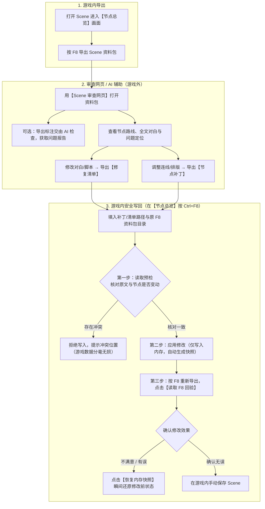

# EC_SceneAudit 游戏插件使用指南

`EC_SceneAudit` 是一款辅助创作者检查、整理和修改 Scene 的游戏内工具。它能将当前正在编辑的 Scene 导出为资料包，供本地「Scene 审查网页」或 AI 进行剧情路线检查、脚本排错；同时支持将你在网页端改好的对白文本、节点连线与排版安全地写回游戏。

**核心安全承诺：** 插件的所有导出与检查均为只读操作；写回修改时**只写入游戏内存，绝不自动覆盖你的存档文件**，并在修改前自动备份内存快照，随时可以一键反悔还原，最终是否保存完全由你决定。

---

## 整体工作流程

插件通常与「Scene 审查网页」配合使用，完整流程如下：

---

## 一、 快捷键与文件路径

| 功能 | 默认快捷键 | 说明 |
| :--- | :--- | :--- |
| **导出 Scene 资料包** | `F8` | 将当前 Scene 的节点、对白、脚本打包导出 |
| **打开修复与补丁窗口** | `Ctrl + F8` | 必须在 HEdit **节点总览**画面下才能打开 |

- **导出文件保存在哪？**
  游戏目录下的 `UserData/PluginData/SceneAudit/{Scene标题}/{年月日}/{批次目录}/`（若 Scene 还没起名，标题目录会用当天日期代替）。每次按 `F8` 都会新建一个独立的批次文件夹，不会覆盖之前的导出。
- **插件配置文件在哪？**
  `BepInEx/config/EC_SceneAudit.cfg`（可在里面修改快捷键，或预先填好常用的文件/目录路径）。

---

## 二、 功能详解

### 1. 按 `F8` 导出 Scene 资料包

在编辑 Scene 时按下 `F8`，插件会将当前 Scene 的结构完整导出为一个资料包文件夹：

- **包含哪些内容**：所有节点（含 `Start`/`End` 系统节点）与连接槽位、节点在画布上的实际位置与尺寸、所有 ADV/H Part、每个 CUT 的对白框原文（含两套文本布局）、`<script>` 脚本命令与引用到的外部脚本文件。
- **自动排错提示**：导出时会自动标记断开的节点、找不到的跳转目标、格式写错的 `<script>` 以及读取失败的外部脚本。
- **整包可随意移动**：生成的资料包内含 `bundle.json` 校验清单，你可以把整个批次文件夹复制到任何地方（或发给别人/AI），不依赖游戏安装路径。
  *(注：若导出中途意外中断，缺少 `bundle.sha256` 的文件夹属于不完整资料包，网页和插件都会自动识别并拒绝使用，防止读入残缺数据。)*

---

### 2. 交给 AI 帮你查错（可选）

如果你想让 AI 帮你检查复杂的多分支剧情、变量控制（Variable Mod）或隐藏死路：

1. 将插件附带的 `ec-scene-review` 文件夹，连同刚刚按 `F8` 导出的**整个批次文件夹**一起发给支持读文件的 AI。
2. 直接对 AI 说：
   > 请先阅读 `ec-scene-review/SKILL.md`，按其中流程审查我提供的导出文件，说明问题位置、触发条件、证据和未验证范围。
3. AI 会输出一份简短说明和 `review-report.json` 审查报告。你可以把这份报告导入「Scene 审查网页」，直接在节点图上高亮查看所有问题点。

---

### 3. 按 `Ctrl+F8` 将网页的对白修改写回游戏

当你在「Scene 审查网页」里改好了错别字、对白或 `<script>` 脚本，并导出了 **`ec-scene-repair-plan.json`（修复清单）** 后，可以按以下步骤写回游戏：

> **注意：** 请先回到 HEdit 的**节点总览**画面（正在编辑单个 ADV/HPart、播放预览或加载画面时无法操作），且**强烈建议操作前先在游戏里手动保存一次当前 Scene**。

1. **填写路径并预检（只读）**
   按 `Ctrl+F8` 打开窗口，填入「修复清单（`ec-scene-repair-plan.json`）」路径和对应的「原 F8 资料包目录」，点击 **「读取预检」**。
   - 插件会逐条比对游戏当前对白与资料包里的原文是否完全一致。
   - 如果你在导出 F8 之后又在游戏里改动过某句台词，预检会直接标出「冲突」并拒绝后续写入，防止覆盖你最新的改动。
   - 点击「导出文字报告」可将预检结果存为 `.txt` 文本备查。
2. **应用修复（仅写内存）**
   预检全部显示「原文一致」后，点击 **「应用修复（仅内存）」**。
   - 插件会先为受影响的节点和 Part 建立内存备份快照，再一次性写入所有新文本。若中途有任何一条写入异常，会自动全部撤销。
3. **F8 回验与反悔恢复**
   - 写入成功后，在游戏里再按一次 **`F8`** 导出最新状态，然后点击窗口里的 **「读取 F8 回验」**，插件会自动核对新文本是否已全部生效、未修改的部分是否完好无损。
   - **如果不满意**：点击 **「恢复内存快照」**，即可将刚才改动的 Part 和节点瞬间还原到修改前的状态。
   - **如果确认无误**：直接在游戏里手动保存 Scene 即可落盘。

---

### 4. 按 `Ctrl+F8` 将网页的连线与节点排版写回游戏

当你在「Scene 审查网页」中调整了节点连线关系或节点位置，并导出了 **`ec-scene-node-patch`（节点补丁）** 后，同样在**节点总览**画面按 `Ctrl+F8` 操作：

1. **读取节点预检**：填入节点补丁文件路径与原 F8 资料包目录，点击 **「读取节点预检」**。
2. **应用节点补丁（仅内存）**：
   - 插件只会修改既有连线的目标端点和节点位置，不会凭空增删节点或选项。
   - **画布自动扩展**：如果网页里排版使用了更大的画布，应用时会弹窗再次向你确认。需要你安装了支持动态扩展的 `EC_NodeSidePanel` 插件才能扩大画布；若环境不支持扩展，插件会安全拒绝整批补丁，不会把节点挤在画布外。
3. **回验与恢复**：
   - 应用后同样按 **`F8`** 重新导出，再点 **「读取节点 F8 回验」** 核对结果。
   - 随时可点 **「恢复节点快照」** 还原连接和位置（已扩大的画布范围会保留）。确认满意后，手动保存 Scene 即可。

---

## 三、 常见注意事项

- **文本修复与节点补丁请分步进行**：同一时间只能保留一种修改的内存恢复快照（不能一边挂着未确认的文本修复快照，一边又去应用节点补丁）。建议做完其中一项、核对无误后，再进行下一项。
- **切换 Scene 后快照会失效**：如果你在应用修改后切换了 Scene 或重新读取了存档，之前的内存备份快照会自动失效。
- **「清除本次记录」不是还原**：窗口中的「清除本次记录」只是丢弃内存备份快照，**不会**把已经写进内存的新文本/新连线退回去。如果想反悔，请务必点「恢复内存快照」或「恢复节点快照」。
