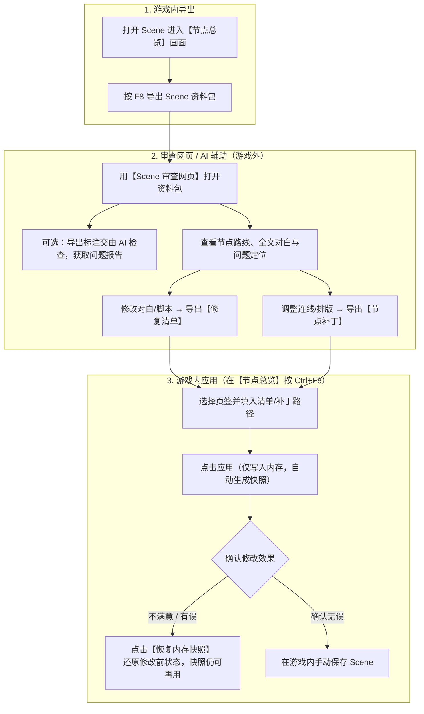

# EC_SceneAudit 游戏插件使用指南

`EC_SceneAudit` 是一款辅助创作者检查、整理和修改 Scene 的游戏内工具。它能将当前正在编辑的 Scene 导出为资料包，供本地「Scene 审查网页」或 AI 进行剧情路线检查、脚本排错；同时支持将你在网页端改好的对白文本、节点连线与排版应用到游戏内存。

**核心安全承诺：** 插件的导出为只读操作；应用修改时**只写入游戏内存，绝不自动覆盖你的存档文件**，并在修改前保留内存快照，随时可以反悔还原，且可反复恢复。最终是否保存完全由你决定。

---

## 整体工作流程

插件通常与「Scene 审查网页」配合使用，完整流程如下：

---

## 一、 快捷键与文件路径

| 功能 | 默认快捷键 | 说明 |
| :--- | :--- | :--- |
| **导出 Scene 资料包** | `F8` | 将当前 Scene 的节点、对白、脚本打包导出 |
| **显示 / 隐藏修复与补丁窗口** | `Ctrl + F8` | 打开时必须在 HEdit **节点总览**画面；窗口已显示时按一下即隐藏 |

- **导出文件保存在哪？**
  游戏目录下的 `UserData/PluginData/SceneAudit/{Scene标题}/{年月日}/{批次目录}/`（若 Scene 还没起名，标题目录会用当天日期代替）。每次按 `F8` 都会新建一个独立的批次文件夹，不会覆盖之前的导出。
- **插件配置文件在哪？**
  `BepInEx/config/EC_SceneAudit.cfg`（可在里面修改快捷键，或预先填好常用的文件路径）。

---

## 二、 功能详解

### 1. 按 `F8` 导出 Scene 资料包

在编辑 Scene 时按下 `F8`，插件会将当前 Scene 的结构完整导出为一个资料包文件夹：

- **包含哪些内容**：所有节点（含 `Start`/`End` 系统节点）与连接槽位、节点在画布上的实际位置与尺寸、所有 ADV/H Part、每个 CUT 的对白框原文（含两套文本布局）、`<script>` 脚本命令与引用到的外部脚本文件。
- **自动排错提示**：导出时会自动标记断开的节点、找不到的跳转目标、格式写错的 `<script>` 以及读取失败的外部脚本。
- **整包可随意移动**：生成的资料包内含 `bundle.json` 校验清单，你可以把整个批次文件夹复制到任何地方（或发给别人/AI），不依赖游戏安装路径。
  *(注：若导出中途意外中断，缺少 `bundle.sha256` 的文件夹属于不完整资料包，网页会识别并拒绝使用，防止读入残缺数据。)*

---

### 2. 交给 AI 帮你查错（可选）

如果你想让 AI 帮你检查复杂的多分支剧情、变量控制（Variable Mod）或隐藏死路：

1. 将插件附带的 `ec-scene-review` 文件夹，连同刚刚按 `F8` 导出的**整个批次文件夹**一起发给支持读文件的 AI。
2. 直接对 AI 说：
   > 请先阅读 `ec-scene-review/SKILL.md`，按其中流程审查我提供的导出文件，说明问题位置、触发条件、证据和未验证范围。
3. AI 会输出一份简短说明和 `review-report.json` 审查报告。你可以把这份报告导入「Scene 审查网页」，直接在节点图上高亮查看所有问题点。

---

### 3. 按 `Ctrl+F8` 将网页的对白修改应用到游戏

当你在「Scene 审查网页」里改好了错别字、对白或 `<script>` 脚本，并导出了 **`ec-scene-repair-plan.json`（修复清单）** 后，可以按以下步骤应用到游戏：

> **注意：** 请先回到 HEdit 的**节点总览**画面（正在编辑单个 ADV/HPart、播放预览或加载画面时无法操作），且**强烈建议操作前先在游戏里手动保存一次当前 Scene**。

1. **填写路径并应用（仅写内存）**
   按 `Ctrl+F8` 打开窗口，切到「文本修复」页，填入「修复清单（`ec-scene-repair-plan.json`）」路径，点击 **「应用修复」**。
   - 插件按节点 UID、CUT / 文本框源序号和布局序号定位当前目标，找到就写入新文本。
   - **不比较当前原文**。如果你在导出 F8 之后又在游戏里改动过某句台词，仍会被清单里的新文覆盖。
   - 找不到的节点、CUT 或文本框直接跳过，不影响其它项；只有文件本身无法解析时才报错。
   - 路径可在配置 `Repair/Plan Path` 预填，点击应用时保存当前填写值。原配置项 `Bundle Directory` 保留兼容，但不再参与应用。
2. **确认结果**
   窗口会显示「已应用 N 项，未保存」并逐项列出「已应用 / 未应用」。应用前已为受影响的节点和 Part 建立内存快照；单项写入失败只撤回该项，其它项保留。
3. **保存或反悔**
   - **如果确认无误**：直接在游戏里手动保存 Scene 即可落盘。
   - **如果不满意**：点击 **「恢复内存快照」**，即可将刚才改动的 Part 和节点还原到修改前的状态。

> **提示：** 本版本没有预检和 F8 回验步骤，也不需要填写原 F8 资料包目录。应用前后都请自行确认实际播放效果。

---

### 4. 按 `Ctrl+F8` 将网页的连线与节点排版应用到游戏

当你在「Scene 审查网页」中调整了节点连线关系或节点位置，并导出了 **`ec-scene-node-patch`（节点补丁）** 后，同样在**节点总览**画面按 `Ctrl+F8` 操作：

1. **应用节点补丁（仅内存）**：切到「节点补丁」页，填入节点补丁文件路径，点击 **「应用节点补丁」**。
   - 插件只会修改既有连线的目标端点和节点位置，不会凭空增删节点或选项。
   - 匹配到的节点位置和来源槽连接会写入；缺失来源节点、目标节点或槽位直接跳过。已移动的节点、变化的旧连接以及补丁外新增的节点，都不会阻止其它修改。
   - 连接的当前条件、次数与渐变参数保持原值。
   - **画布自动扩展**：需要更大画布时，安装了支持动态扩展的 `EC_NodeSidePanel` 会自动扩展；若环境不支持，仍然应用节点，位置由游戏原生范围限制，不会整批拒绝。
2. **恢复**：随时可点 **「恢复节点快照」** 还原连接和位置（已扩大的画布范围会保留）。确认满意后，手动保存 Scene 即可。

---

## 三、 常见注意事项

- **两个页签各自保留快照**：文本修复与节点补丁分别保存最近一次应用前的内存快照，互不影响，可以分别应用和恢复。
- **隐藏不会丢快照**：点「隐藏」或按 `Ctrl+F8` 只改变窗口可见状态；重新打开后仍可恢复，恢复成功后也能再次恢复。
- **重复应用会更新快照**：新应用不受旧快照阻止，成功后使用本次应用前的快照；没有匹配项或读文件失败时，保留原来可用的快照。
- **切换 Scene 后快照会失效**：如果你在应用修改后切换了 Scene 或重新读取了存档，之前的内存备份快照不能用于新 Scene，窗口会明确提示。
- **应用只改内存**：没有手动保存就结束游戏，改动会丢失。本版本不再提供「清除本次记录」，因为恢复可以反复执行。
