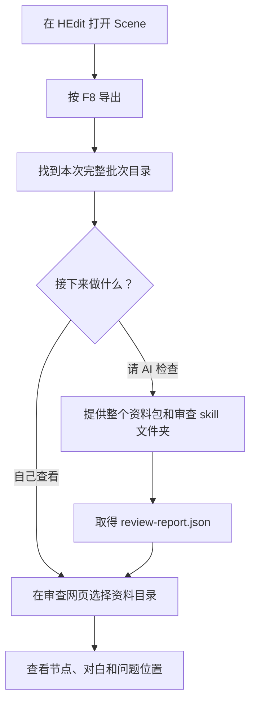
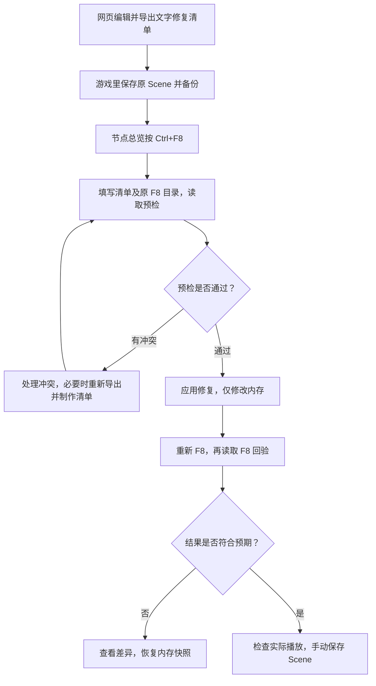

# EC_SceneAudit 玩家使用指南

做好的剧情里有走不到的节点、可疑的跳转，或者想请 AI 帮忙检查脚本？`EC_SceneAudit` 可以把当前 Scene 的节点、对白和脚本导出成一份资料包，供你在网页里查看或交给 AI 审查。

需要修改时，你可以先在网页里准备修复清单，再回到游戏检查、应用和确认结果。

**只查看资料时不会改动游戏。应用修复只改当前内存中的 Scene，最终仍需你在游戏里手动保存。**

## 先选你要做的事

| 你想做什么 | 从哪里开始 |
| --- | --- |
| 导出当前剧情，查看节点和对白 | [按 F8 导出资料](#按-f8-导出资料) |
| 请 AI 检查剧情和脚本 | [把资料交给 AI](#把资料交给-ai) |
| 修改对白或对白中的脚本 | [应用文字修复](#应用文字修复) |
| 调整节点连线和位置 | [应用节点补丁](#应用节点补丁) |

网页的启动、阅读和编辑方法见 [Scene 审查网页玩家指南](review-browser/readme-gpt-6.1-sol.md)。

## 安装与准备

1. 确认游戏已安装 **BepInEx 5.x**。
2. 把编译好的 `EC_SceneAudit.dll` 放入游戏的 `BepInEx/plugins/` 目录，然后重启游戏。
3. 进入游戏的 HEdit 编辑器，打开要检查的 Scene。

本文里几个常用名称：

- **Scene**：你正在编辑的整份场景剧情。
- **Part**：节点对应的剧情片段。
- **CUT**：ADV 片段中的一段内容；网页用它组织对白阅读。
- **F8 资料包**：按 F8 后生成的一整个文件夹，代表那一刻的剧情内容。

## 按 F8 导出资料

1. 打开要检查的 Scene，按 **F8**。
2. 到游戏目录下寻找本次生成的文件夹：

   ```text
   UserData/PluginData/SceneAudit/场景标题/导出日期/批次目录/
   ```

3. 找到**直接包含 `bundle.json` 的那个批次目录**。在网页选择或交给 AI 时，使用整个目录。

每次 F8 都生成独立批次，不覆盖之前的资料。Scene 标题为空时，标题目录使用导出日期。



资料包含节点及连线、关联 Part、ADV 的 CUT 和全部文本布局，以及脚本、变量和跳转信息。能可靠取得节点位置和尺寸时，也会一并导出。

| 文件 | 你需要知道的用途 |
| --- | --- |
| `scene.json` | 完整的剧情资料，包括对白和脚本原文 |
| `ai-summary.json` | 给 AI 快速了解结构的摘要，不能代替完整资料 |
| `bundle.json`、`bundle.sha256` | 用来确认资料齐全、来源一致，请保留 |
| 同目录的外部脚本文件 | 本次剧情实际引用且成功收集的脚本，请一起保留 |

不要只发送摘要，也不要手动改资料包里的文件。整个目录可以复制或移动，不依赖原来的游戏盘符。

导出发现缺失节点、无法读取的外部脚本或脚本格式问题时，会记录提示。**导出成功不等于剧情已经检查通过**；资料包缺少 `bundle.sha256` 时，不能当作完整包使用。

## 把资料交给 AI

向 AI 提供：

- 本次 F8 的**整个批次目录**。
- 插件中的 [`ec-scene-review`](ec-scene-review/SKILL.md) **整个文件夹**，保留里面的参考资料。
- 如果在网页填写了作者标注，再附上 `author-annotations.json` 和 `author-handoff.md`。

可以直接复制这段话：

> 请先阅读 ec-scene-review/SKILL.md，按其中流程审查这份 F8 资料包。请说明问题位置、触发条件、依据和需要在游戏里确认的内容，并输出 review-report.json。

取得报告后，在审查网页的「资料与报告」中选择对应资料包和 `review-report.json`，就能定位报告提到的位置。没有 AI 报告也能浏览资料。

AI 和网页检查的是导出的文字与结构，不会运行游戏脚本。可疑路线、变量和修复结果仍需结合实际播放确认。

## 应用文字修复

先在网页编辑对白或对白中的脚本，再导出 `ec-scene-repair-plan.json`。具体入口见 [网页指南](review-browser/readme-gpt-6.1-sol.md#修改对白或脚本)。

### 1. 先检查清单能否用于当前 Scene

1. **在游戏里手动保存当前 Scene，并保留备份。**
2. 回到 HEdit 的**节点总览**，按 **Ctrl+F8** 打开修复窗口。
3. 填写修复清单路径，以及**制作该清单时使用的原 F8 资料包目录**。
4. 点击「读取预检」，查看每项结果。

「原文一致」表示清单中的原文能对应当前 Scene；「冲突」表示来源、位置或原文有变化，需要先处理。预检不会应用修改，也不证明新脚本能够正常运行。

需要保留检查结果时，点击「导出文字报告」。报告会作为新文件写在清单旁，不改动清单或原资料包。

### 2. 应用后，再导出一份资料核对

1. 预检通过后，点击「应用修复（仅内存）」。应用时插件会再次检查；有冲突就不写入，写入异常会撤销本次修改。
2. 应用成功后，**重新按 F8**，生成应用后的新批次。
3. 点击「读取 F8 回验」，核对修改后的文字，并检查未修改内容是否保持原样。
4. 结果符合预期后，按需要实际播放检查，再在游戏里**手动保存 Scene**。



### 3. 不满意时怎么恢复

- 点击「恢复内存快照」，还原本次修复记录的目标片段、节点和相关连线。
- 回验不通过时，插件会保留差异和快照，**不会自动恢复**。请先查看结果，再决定恢复。
- 恢复需要停留在 HEdit 节点总览。切换 Scene 或重新加载同一 Scene 后，旧快照失效。
- 「清除本次记录」只丢弃恢复记录，**不会撤销已经应用的修改**。
- 快照只覆盖本次涉及的内容，不能代替完整 Scene 备份；它也不会替你还原已经保存到磁盘的文件。

## 应用节点补丁

网页可以修改**已有连线的目标**和节点位置。导出的节点补丁不新增或删除节点、选项，也不会自动写入游戏。

1. 在网页的「编辑与补丁 → 节点补丁」中准备并导出补丁。
2. 在游戏里手动保存当前 Scene 并备份，回到节点总览，按 **Ctrl+F8**。
3. 填写节点补丁路径和对应的原 F8 资料目录。
4. 依次点击「读取节点预检」「应用节点补丁（仅内存）」。
5. 重新按 **F8**，再点击「读取节点 F8 回验」。
6. 确认后手动保存 Scene；不满意时恢复节点快照。

要把网页里的精确布局带回游戏，需要带有节点位置和尺寸的新 F8 资料包。需要扩大游戏画布时，还须安装支持动态扩展的 **EC_NodeSidePanel**；不支持时整批补丁会被拒绝。扩展前会再次确认，恢复节点快照后扩大的画布仍会保留。

**文字修复与节点补丁不能同时保留有效恢复会话。** 先完成当前修改的回验并手动保存，或恢复当前修改。确认不再需要撤销后，清除本次记录，再开始另一类修改。

## 常见问题

| 遇到的情况 | 怎么处理 |
| --- | --- |
| Ctrl+F8 无法预检或恢复 | 回到 HEdit 节点总览；ADV/HPart 编辑、播放、加载和基础设置期间不能预检 |
| 清单显示冲突 | 确认打开了正确 Scene，并使用清单对应的原批次；剧情已改动时重新 F8，再在网页更新资料或重新制作清单 |
| 回验不接受资料包 | 使用本次应用之后新导出的批次，并保留本次清单和原资料包；旧批次不能代替回验资料 |
| 应用后重新加载，修改消失了 | 应用只改内存，尚未手动保存的修改不会写入 Scene 文件 |
| 想调整快捷键或预填路径 | 编辑游戏里的 `BepInEx/config/EC_SceneAudit.cfg`；导出键默认 F8，`Config` 段的 `Repair Preflight` 默认 Ctrl+F8，`Repair` 段可填 `Plan Path` 和 `Bundle Directory` |

离开节点总览、重新打开修复窗口或改动路径后，需要重新读取预检结果。
