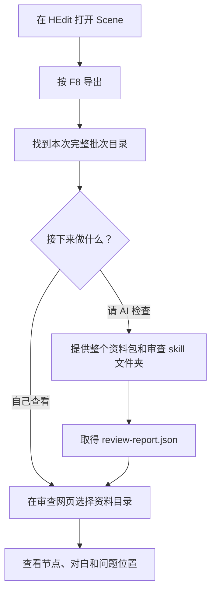

# EC_SceneAudit 玩家使用指南

做好的剧情里有走不到的节点、可疑的跳转，或者想请 AI 帮忙检查脚本？`EC_SceneAudit` 可以把当前 Scene 的节点、对白和脚本导出成一份资料包，供你在网页里查看或交给 AI 审查。

需要修改时，你可以先在网页里准备修复清单，再回到游戏直接应用。

**只查看资料时不会改动游戏。应用修复只改当前内存中的 Scene，最终仍需你在游戏里手动保存。**

## 先选你要做的事

| 你想做什么 | 从哪里开始 |
| --- | --- |
| 导出当前剧情，查看节点和对白 | [按 F8 导出资料](#按-f8-导出资料) |
| 请 AI 检查剧情和脚本 | [把资料交给 AI](#把资料交给-ai) |
| 修改对白或对白中的脚本 | [应用文字修复](#应用文字修复) |
| 调整节点连线和位置 | [应用节点补丁](#应用节点补丁) |

网页的启动、阅读和编辑方法见 [Scene 审查网页玩家指南](review-browser/readme-gpt-6.1-sol.md)。

## 安装与准备

1. 确认游戏已安装 **BepInEx 5.x**。
2. 把编译好的 `EC_SceneAudit.dll` 放入游戏的 `BepInEx/plugins/` 目录，然后重启游戏。
3. 进入游戏的 HEdit 编辑器，打开要检查的 Scene。

本文里几个常用名称：

- **Scene**：你正在编辑的整份场景剧情。
- **Part**：节点对应的剧情片段。
- **CUT**：ADV 片段中的一段内容；网页用它组织对白阅读。
- **F8 资料包**：按 F8 后生成的一整个文件夹，代表那一刻的剧情内容。

## 按 F8 导出资料

1. 打开要检查的 Scene，按 **F8**。
2. 到游戏目录下寻找本次生成的文件夹：

   ```text
   UserData/PluginData/SceneAudit/场景标题/导出日期/批次目录/
   ```

3. 找到**直接包含 `bundle.json` 的那个批次目录**。在网页选择或交给 AI 时，使用整个目录。

每次 F8 都生成独立批次，不覆盖之前的资料。Scene 标题为空时，标题目录使用导出日期。



资料包含节点及连线、关联 Part、ADV 的 CUT 和全部文本布局，以及脚本、变量和跳转信息。能可靠取得节点位置和尺寸时，也会一并导出。

| 文件 | 你需要知道的用途 |
| --- | --- |
| `scene.json` | 完整的剧情资料，包括对白和脚本原文 |
| `ai-summary.json` | 给 AI 快速了解结构的摘要，不能代替完整资料 |
| `bundle.json`、`bundle.sha256` | 用来确认资料齐全、来源一致，请保留 |
| 同目录的外部脚本文件 | 本次剧情实际引用且成功收集的脚本，请一起保留 |

不要只发送摘要，也不要手动改资料包里的文件。整个目录可以复制或移动，不依赖原来的游戏盘符。

导出发现缺失节点、无法读取的外部脚本或脚本格式问题时，会记录提示。ADV Part 在最后 CUT 的可用出口没有目标、也没有跳转脚本时，摘要会给出 `part-no-exit` 并指出空出口编号。**导出成功不等于剧情已经检查通过**；资料包缺少 `bundle.sha256` 时，不能当作完整包使用。

## 把资料交给 AI

向 AI 提供：

- 本次 F8 的**整个批次目录**。
- 插件中的 [`ec-scene-review`](ec-scene-review/SKILL.md) **整个文件夹**，保留里面的参考资料。
- 如果在网页填写了作者标注，再附上 `author-annotations.json` 和 `author-handoff.md`。

可以直接复制这段话：

> 请先阅读 ec-scene-review/SKILL.md，按其中流程审查这份 F8 资料包。请说明问题位置、触发条件、依据和需要在游戏里确认的内容，并输出 review-report.json。

取得报告后，在审查网页的「资料与报告」中选择对应资料包和 `review-report.json`，就能定位报告提到的位置。没有 AI 报告也能浏览资料。

AI 和网页检查的是导出的文字与结构，不会运行游戏脚本。可疑路线、变量和修复结果仍需结合实际播放确认。

## 应用文字修复

在网页编辑并导出 `ec-scene-repair-plan.json`，回到 HEdit 节点总览按 **Ctrl+F8**。
在「文本修复」页填写清单路径，点击「应用修复」。

插件按当前 UID、CUT/文本框源序号和布局序号写入新文本。
已经改过的原文也可以替换；缺失项直接跳过，其它项照常应用。
无需填写原 F8 目录，也无需预检或 F8 回验。

## 应用节点补丁

在网页导出节点补丁，回到游戏修复窗口的「节点补丁」页。
填写补丁文件路径，点击「应用节点补丁」。

匹配到的节点位置和连接会应用。补丁也可以给可用的空出口槽指定新目标。
缺失节点、目标或槽位直接跳过，额外节点不影响操作。
当前条件、次数与渐变参数保持原值。

需要扩大画布时使用 EC_NodeSidePanel 的扩展能力。
没有该能力也会应用，位置由游戏原生范围限制；恢复不会缩小画布。

## 隐藏后仍可恢复

点击「隐藏」或按 Ctrl+F8 只隐藏页面，再按 Ctrl+F8 重新打开。
两个页签各自保留最近一次应用前的内存快照。

「恢复内存快照」可反复点击，恢复成功不会释放快照。
恢复只处理仍存在的目标；已删除节点不会重新创建。
切换或重新加载 Scene 后，旧快照不能用于新 Scene。

新应用无需先恢复或清除记录。没有匹配项或读文件失败时保留原快照。
需要保存应用结果时，在游戏里手动保存。

## 快捷键与路径配置

- `F8`：导出当前 Scene 资料。
- `Ctrl+F8`：显示或隐藏修复窗口。
- 配置文件：`BepInEx/config/EC_SceneAudit.cfg`。
- 原快捷键配置键 `Config/Repair Preflight` 保持不变。
- 文本和节点文件路径分别保存在 `Repair/Plan Path`、`Repair/Node Patch Path`。
- 应用与恢复在 HEdit 节点总览执行，页面隐藏不会清除结果或快照。
