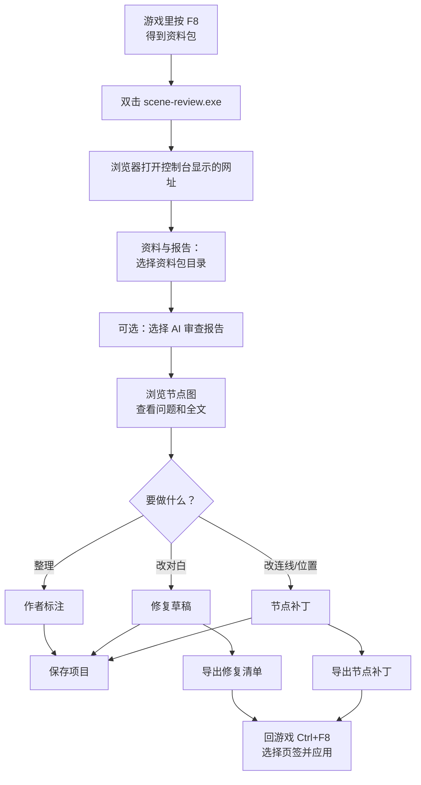
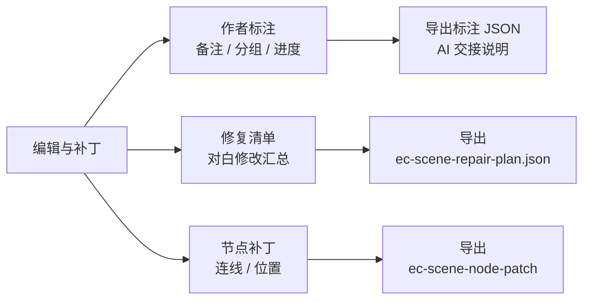
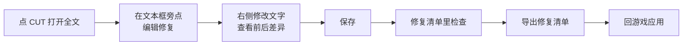
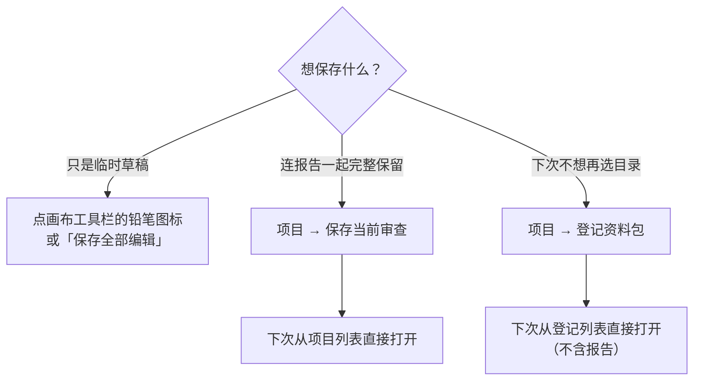
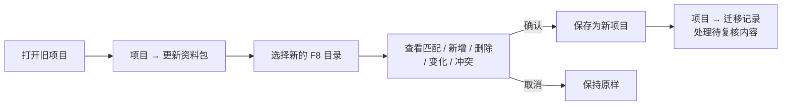

# Scene 审查网页 玩家使用说明

Scene 审查网页是 EC_SceneAudit 插件的配套工具。它在你的电脑上运行，用浏览器打开，可以：

- 以节点图的形式查看整个场景，点节点就能读每个 CUT 的对白全文；
- 打开 AI 的审查报告，直接跳到有问题的位置；
- 给节点写备注、分组，方便自己整理或交给 AI；
- 修改对白、调整连线和节点位置，导出文件带回游戏应用。

网页**不会改动游戏**，也不会改动你的原始 F8 导出目录。不需要联网。

---

## 整体流程

---

## 启动

1. 双击 `scene-review.exe`，会弹出一个黑色控制台窗口，显示本地网址（默认 `http://127.0.0.1:18762`）。
2. 在浏览器里打开这个网址。
3. 用完后关掉控制台窗口，服务就停止了。

只需要这一个 exe 文件，不用安装其它软件。

**端口被占用？** 打开 exe 旁边的 `config.json`（第一次运行会自动生成），改一下端口号再启动。各字段说明见同目录的 `config.README.txt`。

---

## 打开资料

1. 点顶部「资料与报告」，选择**直接包含 `bundle.json` 的那个批次目录**（不要选它的上一层）。
   浏览器可能把这个操作叫「上传」，实际只在本机读取。
2. 可选：再选当前的审查报告 JSON；如果报告是修订版，可以一起选上前一版。
   前一版可以来自同一 Scene 的旧导出批次：改完重新按 F8 后，把旧报告放进“前一版”，新报告按问题 ID 核对。
3. 每次选完会自动核验。关闭导入窗口，开始浏览。

核验失败时网页会说明原因，不会用旧资料冒充新资料。

---

## 浏览与阅读

- **看问题**：在问题列表里点一项，画面会定位到对应节点。一个问题涉及多处时，可以逐个点选。空心标记代表共用的外部脚本，需要再选具体是哪处调用。
- **读对白**：点节点读取它的 CUT，用滑条前后翻看；到达边界时可以选择接下来走哪条路线。点某个 CUT 可以查看所有文本框和布局的原文。
- **找 Part**：在搜索框输入 Part 名称（不区分大小写和空格），用 `↑` `↓` 选择、`Enter` 跳转、`Esc` 关闭。

### 画布操作

| 操作 | 效果 |
| --- | --- |
| 左键拖动空白处 | 框选节点 |
| 左键拖动节点 | 移动节点（选中多个时一起移动） |
| 右键拖动 | 平移画布 |
| 滚轮 | 缩放 |
| `H` | 切换到平移模式，左右键都能拖动画布 |
| `V` | 回到选择模式 |
| `Ctrl` + 点击 | 多选 |
| `Ctrl+Z` / `Ctrl+Y` | 撤销 / 重做（最多 20 步） |
| 拖动时按住 `Alt` | 临时关闭吸附 |

在输入框里打字时，`H` / `V` 不会触发。

### 怎么理解连线

- **实线连线**：节点之间的普通连接。标注「未启用」的是游戏里设为 NotUsed 的出口。
- **脚本连线**：根据脚本里的 goto 推算出的可能去向，**不代表游戏一定会走这条路**。
- 遇到动态目标、重名目标、找不到的 CUT 等情况，网页会直接提示，不会猜测补全。
- Start / End 等系统节点没有对白，这是正常的。

---

## 编辑与补丁

点顶部「编辑与补丁」打开编辑面板，再点一次收起。面板在右侧，可以拖动调宽。切换页签或收起面板都**不会丢失**正在写的内容。

### 作者标注

用来给节点记笔记，方便自己整理或交给 AI。

1. 选中节点，打开「编辑与补丁 → 作者标注」。
2. 在「标注内容」里填写：主线/支线、所属分组、阶段、完成状态、备注。输入后回车新建，或从下拉列表选已有的值，点 `×` 移除。
3. 一个节点可以属于多个分组。组备注是整组共用的。
4. 多选节点可以批量填写，只会修改你勾选的字段。
5. 点「保存全部编辑」保存。

标注过的节点左上角会显示「注」和分组名。右上角的标记是审查报告里的问题，两者不同。

**交给 AI**：点「导出标注 JSON」和「下载 AI 交接说明」，连同原 F8 资料包和 `ec-scene-review` 文件夹一起交给 AI。

### 修复对白

1. 点 CUT 查看全文，在要改的文本框旁点「编辑修复」。
2. 左边是原文（只读），右边写修改后的内容，脚本也可以一起改。
3. 下方「前后差异」中，红色是改前，绿色是改后。
4. 顶部有「恢复原文」「保存」「返回」三个按钮。「恢复原文」会删掉这一项修改。
5. 在「编辑与补丁 → 修复清单」里查看所有修改，确认后点导出，得到 `ec-scene-repair-plan.json`。

改了脚本里的 goto，画面上的跳转连线会跟着预览变化；恢复原文后回到原来的样子。

### 修改连线和节点位置

1. 打开「编辑与补丁 → 节点补丁」。
2. 右键节点或连线，搜索新的目标节点；也可以选中连线后拖动它的终点到另一个节点上。
   选中节点后，面板会列出它的可用空出口槽，选一个目标就能新建连接。
3. 拖动节点调整位置。排列菜单里有对齐、等间距和吸附。
4. 选中连线后拖动绿色控制点可以调弯曲程度（只影响网页显示，不进游戏）。
5. 画布大小可以从下拉框选（游戏原始大小或 1～10 倍）。
6. 点「导出补丁」得到节点补丁文件。

可以修改**已有连线的指向**、给**可用空出口槽**指定目标，以及调整**节点位置**；不能增删节点、选项或输出口。

几个恢复按钮：

| 按钮 | 作用 |
| --- | --- |
| 恢复原始连接 | 连线回到原样，位置不动 |
| 恢复游戏布局 | 位置回到游戏里的样子，连线不动 |
| 清除全部 | 两者都恢复 |
| 自动排列 | 自动整理节点位置，可以撤销 |

以上操作都可以撤销。

### 带回游戏

导出的修复清单或节点补丁，回到游戏后按 `Ctrl+F8` 打开修复窗口，切到对应页签、填写文件路径后直接应用。详见 [插件使用说明](../Readme-claude-opus-5.5.md#第三步把修改带回游戏)。

---

## 保存与项目

网页的所有内容（标注、修复草稿、布局、连线补丁、项目）都保存在 exe 旁边的 `data/` 文件夹里。换浏览器、清空浏览器缓存都不会丢。

- **项目**：保存完整资料、报告、标注、布局和修复草稿。下次打开网页，从「项目」列表点「打开」就能继续。修改后要再保存一次才会更新。
- **登记资料包**：把资料包复制一份进 `data/`，以后不用再选目录。登记不保存报告，需要报告请另存为项目。
- **画布上的保存按钮**：打开了项目时是软盘图标，等同保存项目；没打开项目时是铅笔图标，只保存草稿。
- 删除项目或登记项，只删 `data/` 里的副本，原始 F8 目录不受影响。

建议同时保留原 F8 资料包和报告，并导出一份标注 JSON、修复 JSON 作为备份。

**从旧版升级**：旧版存在浏览器里的数据不会自动搬过来，请重新选择资料包并保存一次项目。

---

## 场景改了之后：更新资料包

在游戏里改了场景并重新按 F8 后，可以把旧项目的标注和草稿搬到新资料包上：

- 没变化的节点：标注和位置原样保留。
- 有变化的节点：列为「待复核」，需要你再看一遍。
- 修复草稿：重新核对原文，对不上的会被隔离，不会混进导出清单。
- 节点补丁：旧补丁只保留记录供查看，需要在新资料上重新做。
- 旧的 AI 报告进入历史记录，新资料包需要重新审查。
- 原项目会保留，不会被覆盖。

---

## 常见问题

**选了目录提示不完整？**
请选直接包含 `bundle.json` 的批次目录。如果确实缺 `bundle.sha256`，说明当时导出失败了，请回游戏重新按 F8。

**磁盘上的文件改了，网页没变化？**
网页读取的是你选择那一刻的内容，需要重新选择目录。

**为什么有的布局不能编辑？**
没有原始文本或索引的布局只能查看。旧版插件导出的资料包没有节点尺寸信息，精确布局需要用新版插件重新 F8。

**网页提示存储不可用？**
说明本地服务出了问题，网页会降级为只读浏览。请检查控制台窗口的提示，确认 `data/` 文件夹可以写入。

**审查报告标记通过了，问题就一定解决了吗？**
不一定。核验只确认报告引用的位置真实存在，结论对不对、修改后能不能正常运行，还需要回游戏实际试玩。
