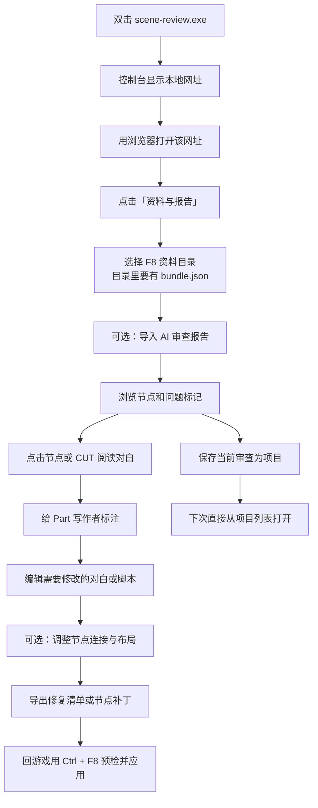

# Scene 审查网页 玩家使用说明

在本机浏览器里查看 F8 导出的 Scene 资料：节点怎么连、问题在哪、每句对白和脚本写了什么。可以直接给 Part 写标注、编辑修复草稿，再把修复清单或节点补丁交给游戏插件应用。

网页不联网，不需要安装 Node.js，也不会修改原始导出目录或游戏文件。

## 它能做什么

- 把 F8 资料里的节点、Part、CUT 和对白原文画成一张可操作的节点图。
- 标出 AI 审查报告里的问题位置，点击就能跳过去看。
- 逐句查看对白、文本布局和内嵌脚本。
- 给 Part 写作者标注，导出后交给 AI 或其他人继续审查。
- 编辑对白修复草稿，导出 `ec-scene-repair-plan.json`。
- 调整已有节点连接和摆放，导出节点补丁。
- 把整份审查保存成项目，下次直接打开继续。

## 开始前准备

- 一份游戏里按 `F8` 导出的资料目录。
- 可选：AI 审查生成的 `review-report.json`，以及它的前一版报告。
- 不需要联网，不需要安装 Node.js，不需要浏览器插件。

如果还没有 F8 资料，先看 [EC Scene Audit 玩家说明](../readme-deepseek-v4.1-flash.md)。

## 启动

1. 把 `scene-review.exe` 放在一个有写入权限的文件夹里。不要放在 `Program Files` 这类普通用户不能写的位置。
2. 双击运行。
3. 控制台窗口会打印本地网址，默认是 `http://127.0.0.1:18762`。
4. 用浏览器打开这个网址。
5. 关闭控制台窗口，服务就停止了。

首次运行会在 exe 同目录生成 `config.json` 和 `config.README.txt`。端口、数据目录都写在 `config.json` 里。

如果端口被占用，程序会在控制台说明原因并退出。改 `config.json` 里的端口，或者启动时加 `--port`，不需要重新编译。临时改数据目录可以用 `--data-root`。

## 完整流程



## 第一步：导入资料

1. 点击顶部“资料与报告”。
2. 选择**直接包含 `bundle.json` 的那个 F8 批次目录**。浏览器的选择框可能把选目录写成“上传”，实际只是在本机读取，不会写入原始目录。
3. 可选导入当前报告 JSON，以及它的前一版 JSON。
4. 每次选择后会自动核验。核验完成，关闭导入窗口即可开始浏览。

正确的目录结构大致是：

```text
批次目录/
├── bundle.json
├── bundle.sha256
├── scene.json
├── ai-summary.json
└── dependencies/
```

几个常见提示：

- 选错层级、目录不完整时，网页不会拿旧图冒充新资料。
- 报告核验失败时，已经核验的资料会保留，但问题标记会停用。
- 重新选择资料目录时，旧的报告选择和问题标记会先被清空。
- 修订版报告没有提供前一版时仍然可以阅读，会提示 `history-unavailable`；提供前一版后会核对修订关系。

## 第二步：浏览节点和问题

- 节点右上角的问题标记来自审查报告。点击标记或问题列表，会定位到对应节点。
- 共享外部脚本的调用点使用空心标记，需要你选择具体是哪一个调用位置。
- 点击节点查看它关联的 CUT。滑条只覆盖这个 Part 的范围，前后阅读位置互相独立。
- 到达 CUT 边界后，可以选择接下来走哪条路线。
- 点击 CUT 可以看到它下面所有文本框和布局的原文。

搜索 Part：

- 直接输入名称，忽略大小写和空白。
- 点击候选，或者用 `↑` `↓` 选择、`Enter` 跳转、`Esc` 关闭。
- 跳转后会沿用这个 Part 上次的 CUT 阅读位置，当前问题说明不会被清掉。

画布操作：

- 左键拖动或框选节点，拖动选区可以成组移动。
- 右键拖动平移画布。
- 按 `H` 切到平移模式，左右键都能平移；按 `V` 回到选择模式。
- 输入文字、打开全文或导入窗口时，不会响应 `H` / `V`。
- 滚轮缩放。
- 拖动过程中按 `Esc`、切换模式或窗口失去焦点会取消拖动。
- 节点布局会保存到数据目录。

## 第三步：作者标注（可选）

标注是给 AI 或其他人看的“作者意图说明”，不会改变原始证据。

1. 选中节点，打开顶部“编辑与补丁”，进入“作者标注”。
2. 填写主线/支线、所属分组、阶段、完成状态和 Part 独立备注。
3. 输入文本后回车新建，或从下拉胶囊里选择已有值。点 × 移除。
4. 一个 Part 可以属于多个分组，但阶段只有一个。组共用备注在组里单独编辑，同组 Part 都能看到。

节点左上角会显示“注”和分组名，悬停可以看完整组名。右上角的问题标记仍然属于审查报告，两者互不覆盖。

“审查范围”“标注内容”“已有标注”三个按钮用来切换视图，不会清除正在编辑的内容。面板可以收起，也可以从顶部重新打开；点击另一个节点的作者标记时，会切换选区并保留原草稿。

批量填写：

- 按住 `Ctrl` 多选，或者在画布上框选。
- 只修改勾选的字段，未勾选的备注保持原样。
- 批量设置所属分组会替换选中节点的分组集合。

点击“保存全部编辑”会写入数据目录。只切换页面、最小化或关闭窗口不会清除草稿，但**刷新网页前仍然需要保存**。

导出与交接：

- “导出标注 JSON”和“下载 AI 交接说明”会先收集并保存当前全部编辑，再下载文件。
- 交给外部 AI 时，同时提供：原 F8 资料包、`author-annotations.json`、`author-handoff.md` 和 `ec-scene-review` skill 文件夹。
- 标注是作者意图，不能替代脚本事实。

导入标注会替换当前作者标注，并恢复文件附带的布局。建议先导出备份。错批次、未知节点或格式错误会被拒绝，当前内容保留。如果是新一批 F8 资料，请用后面的“更新资料包”，不要直接导入旧标注。

## 第四步：编辑修复草稿

1. 点击 CUT 查看全文。
2. 在具体文本框的布局旁点击“编辑修复”。
3. 左侧保留只读原文，右侧修改整段对白，以及其中的脚本。
4. 有多个布局时分别编辑，网页不会猜游戏当前使用的是哪一份。

编辑区提示：

- “前后差异”用红色显示替换前的行，绿色显示替换后的行。
- 较长的差异会省略部分行，完整内容仍保留在上方和导出文件中。
- 输入会自动记录并写入数据目录。关闭或切换编辑对象，有效草稿仍然保留。
- 把新文清空表示改成空文本；“恢复原文”会移除这一项。

编辑页顶部只有一行工具按钮：`恢复原文`、`保存`、`返回`。保存只写入数据目录草稿，不会关闭编辑页。

“编辑与补丁 → 修复清单”：

- 每项默认收起，标题旁有“定位”“继续编辑”“移除”。
- 展开后可以看到原文和新文。
- 点击“导出”生成 `ec-scene-repair-plan.json`。
- 导入会整体替换当前清单。来源错误、位置错误、原文对不上或条目重复时整份拒绝，当前草稿保留。

每项最多 1,000,000 个字符，整份清单最多 1000 项。超出时会提示，并保留当前输入供你调整。

网页只编辑草稿，不改游戏。导出的清单要回到游戏里，用 `Ctrl + F8` 预检并应用。原 CUT、连线和问题标记仍然反映 F8 当时的证据；网页也不会执行或验证你改完的脚本能不能运行。

## 第五步：节点连接与布局（可选）

打开“编辑与补丁 → 节点补丁”，可以修改已有连接：

- 右键节点或普通连线，搜索目标节点。
- 选中普通连线后，也可以拖动目标端点，释放到有效节点上才会写入。
- 候选会保留系统节点，并排除来源自身。
- 空白处、`Esc`、来源自身、脚本边和未知目标都不会改动补丁。
- 节点、选项和输出槽的数量不变，条件、计数和淡入淡出参数保持原样。

调整完成后点击“导出补丁”，会下载独立的 `ec-scene-node-patch` 文件。游戏端还会重新核验一次，网页修改不会自动应用到游戏。

布局方面：

- 新 F8 资料带完整几何时，节点会直接按游戏里的矩形和位置显示。
- 普通连线默认是曲线；可以拖动绿色控制点调整曲率，端点不动。
- 排列菜单提供对齐基准、六种对齐、等间隔和吸附。
- 对齐至少需要两个节点；等间隔至少需要三个节点。
- 拖动节点时会显示参考线；吸附可以关闭，也可以按住 `Alt` 临时禁用。
- 画布大小用固定下拉选择，可以是原游戏画布或 1～10 倍，修改后立即刷新。
- “恢复原始连接”保留位置；“恢复游戏布局”保留连接；“清除全部”两者都恢复并清除网页路线。三者都保留当前画布尺寸，并且可以撤销。

撤销与重做：

- `Ctrl + Z` 撤销，`Ctrl + Shift + Z` 或 `Ctrl + Y` 重做。
- 输入框里仍然是浏览器原生的文本撤销。
- 一次操作对应一条历史，最多保留 20 条，新操作会清除重做。
- 面板可以切换“全部/仅已修改”，查看原值与新值，并定位或单项恢复。

画布工具栏的保存按钮有两种形态：

- 已经打开项目时是软盘图标，点击等于“项目 → 保存当前审查”，用当前项目名更新快照。
- 没有打开项目时是铅笔图标，只把布局和连线草稿写入数据目录，不会创建项目。

要连报告和标注一起保留，仍然用“项目 → 保存当前审查”。

## 保存项目与数据目录

### 保存当前审查

加载资料后填写项目名，点击“保存当前审查”，会把完整资料、当前/前版报告、作者标注、布局和修复草稿写入数据目录。未保存的编辑也会一并收集。

下次打开网页，从项目列表点击“打开”就能继续，不需要再选文件。修改后要再次保存项目，快照才会更新。

同一批资料对应一个项目，可以改名、更新或删除。删除只会移除数据目录里的项目副本，原始 F8 导出目录不变。

项目按资料身份唯一，数据副本与浏览器、端口无关。换浏览器或清空浏览器数据后，项目仍然可以打开。仍建议保留原 F8 包和报告，并分别导出标注 JSON、修复 JSON 作为备份。

### 已登记资料包

“资料与报告”对话框下方是“已登记资料包”：

- 点“登记资料包”，选择一次目录。
- 服务端核验整包后，会复制进数据目录。
- 此后列表一直可见，下次启动或换浏览器后都能直接点“打开”，不必再选目录。
- 删除登记只移除副本，原始导出目录不变。
- 校验失败的资料包会被拒绝，不会留下半份副本。

打开登记项时，它和“选择本机目录”共用同一份标注、修复、布局和连线草稿。登记区不保存报告和前版报告；打开后报告为空，需要保留报告或编辑时请另存为项目。

### 数据目录

项目、标注、修复草稿、布局和连线补丁都在 exe 同级的 `data/` 目录：

```text
data/
├── projects/<哈希>/project.json + files/<相对路径>   项目快照
├── registry/<哈希>/                                  已登记资料包副本
└── drafts/{annotations,repairs,layout,node-patch}/<哈希>.json   四类草稿
```

目录名是资料包身份的哈希，网页列表里显示的仍是原始 id 和名称。删除项目或登记项只删数据目录里的副本。

如果数据目录不可写，网页会提示原因，并降级为只读浏览。

### 更新资料包

完成一次修改或重新导出 F8 后，可以更新已有项目：

1. 打开原项目，点击“项目 → 更新资料包”。
2. 选择新的完整 F8 导出目录。
3. 先查看匹配、新增、删除、变化和草稿冲突。
4. 确认后会保存并打开新项目；取消不会替换当前视图。

原项目会保留。如果新包已经对应一个项目，会拒绝覆盖。

同 UID、同类型节点会保留分组、备注、阶段、状态和网页位置；新增节点采用新包位置。文本、结构或连线变化会列为待复核项；删除和类型冲突的旧内容会保留在记录中。

修复草稿会重新检查位置和原文。结构或文本发生变化时会保守隔离，冲突项不会进入可导出的清单；已经达到目标文本的条目不重复应用。旧 AI 报告保存在历史记录里，新包当前报告为空，需要重新审查。

从“项目 → 迁移记录”可以查看旧标注、冲突草稿和历史报告，在现有入口重新整理或明确放弃；处理状态会保留。

## 回到游戏应用

网页不会改游戏。正确的收尾是：

1. 在网页导出修复清单 `ec-scene-repair-plan.json`，或节点补丁文件。
2. 回到游戏，在 HEdit 节点总览按 `Ctrl + F8`。
3. 先做预检，确认全部“原文一致”。
4. 手动保存一次 Scene 作为退路，再点击应用（仅内存）。
5. 重新按 `F8` 导出，读取回验。
6. 满意后自己手动保存 Scene；不满意就恢复内存快照。

具体步骤见 [EC Scene Audit 玩家说明](../readme-deepseek-v4.1-flash.md)。

## 常见问题

**双击后没反应，或者提示端口被占用？**

看控制台窗口的提示。端口被占用时，程序会说明并以非 0 退出码结束。改 `config.json` 里的端口，或者启动时加 `--port`，不需要重新编译。

**浏览器打不开网页？**

用控制台打印的 `http://127.0.0.1:端口` 地址，确认控制台窗口没有关闭。不要用静态预览脚本启动，那种模式没有本地服务，网页功能不完整。

**选择目录后提示资料不完整？**

必须选择直接包含 `bundle.json` 的那一个 F8 批次目录。选上层文件夹、选单个文件都不行。

**报告导入失败？**

报告必须和当前资料包来自同一批 F8。核验失败时资料仍然保留，但问题标记会停用。可以重新导出报告，或者不带报告继续阅读和编辑。

**刷新网页后要重新选资料？**

没有保存项目时，刷新后需要重新选择目录和报告。修复草稿等已经写入数据目录的内容仍可能按资料身份恢复。想省掉这一步，用“保存当前审查”存成项目。

**换浏览器或清空浏览器数据，项目会丢吗？**

不会。项目、标注和草稿都在 `data/` 目录里，与浏览器无关。但原始 F8 资料包和报告仍然建议保留。

**需要联网吗？**

不需要。所有文件都在本机读取，服务只监听本机地址。

**网页里的修改会自动进游戏吗？**

不会。必须导出清单或补丁，回到游戏用 `Ctrl + F8` 预检并应用。

**改完的脚本会自动验证吗？**

不会。网页只展示静态草稿和跳转预览，不执行脚本，也不能保证修改后的逻辑一定正确。

**删除项目会删掉原始 F8 导出吗？**

不会。只删除 `data/` 里的副本。

**能增删节点、选项或输出槽吗？**

不能。节点补丁只修改已有连接的目标和节点位置。

**旧资料没有精确布局怎么办？**

旧包没有完整几何时，仍然可以阅读、标注、修复和编辑连接，但无法精确布局。重新按 `F8` 导出一次，再更新资料包即可。

**以前版本保存的数据还在吗？**

旧版把项目放在浏览器 IndexedDB、把草稿放在 localStorage，不会自动迁移到 `data/`。升级后需要重新选择资料包并保存一次项目，旧浏览器数据可以自行清理。

## 使用边界

- 网页展示的是 F8 当时的静态证据，不代表实际运行时一定这样走。
- 普通连线显示导出中有目标的出口；未启用的出口会在路线文字里注明。
- 脚本连线是静态候选，不表示运行时必然执行。
- 动态目标、重名目标、未知 CUT、循环和缺口会明确停止，不会按相似名称猜目标。
- 选项按导出里的真实映射显示，不能靠显示顺序猜槽位。
- 全文会展示所有布局原文，不推定哪份布局当前可见，也不猜说话人。
- 外部脚本必须自带字面小写的 `<script>…</script>` 包裹，游戏才会执行；没有包裹时按普通文本处理，网页同样不会替你补包装。
- 页面不执行脚本，不保存游戏，也不修改外部依赖文件。引用核验通过，不等于报告结论正确，更不等于游戏里的问题已经修好。

最终效果仍然需要在游戏里实际试用确认。
