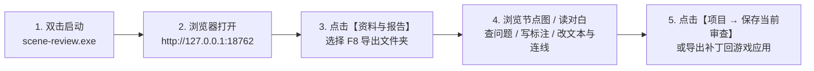
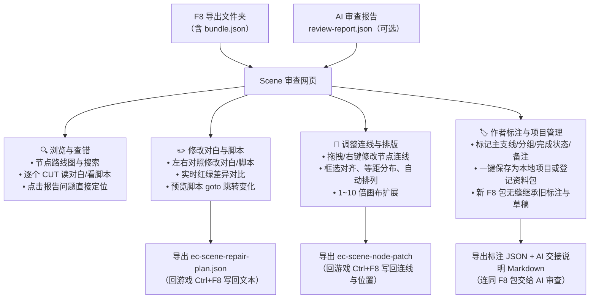

# Scene 审查网页（`scene-review.exe`）使用指南

「Scene 审查网页」是一个运行在你自己电脑上的可视化辅助工具。你可以用它打开游戏中按 `F8` 导出的 Scene 资料包，在清晰的节点图上查看剧情走向、搜索节点、阅读全部 CUT 对白与脚本、查看 AI 审查报告指出的问题位置，并直接在网页里修改对白文本、调整节点连线与排版、记录创作备注。

**安全与隐私说明：**
- **免安装、零配置、不联网**：双击单个 `scene-review.exe` 即可使用，所有资料只在你本机读取。
- **绝不破坏原始文件**：网页不会改动你导出的原始 F8 资料包，也不会直接改动游戏存档；你在网页里做的修改会导出为独立的「修复清单」或「节点补丁」，由你在游戏内按 `Ctrl+F8` 预检确认后才生效。

---

## 一、 快速上手流程

### 1. 启动与关闭
1. 双击运行 **`scene-review.exe`**，会弹出一个黑色控制台窗口，上面显示本地网址（默认为 `http://127.0.0.1:18762`）。
2. 打开任意浏览器（Chrome / Edge 等），访问 `http://127.0.0.1:18762` 即可进入网页。
3. 用完后直接关闭黑色控制台窗口，后台服务即停止。

> **小贴士：如果提示端口被占用怎么办？**
> 首次运行后，程序同目录下会自动生成 `config.json` 配置文件（旁边的 `config.README.txt` 有详细说明）。用记事本打开 `config.json`，把里面的端口号 `18762` 改成其他数字（如 `18763`）再双击启动即可。

### 2. 导入 F8 资料包与报告
1. 点击页面顶部的 **「资料与报告」**。
2. 选择你在游戏里按 `F8` 导出的**最内层批次文件夹**（即直接包含 `bundle.json` 的那个文件夹）。
   *(注：浏览器自带的选择框可能会提示「上传文件夹」，实际上只是在本地读取，不会上传到任何网络，也不会修改原文件夹。)*
3. **（可选）加载审查报告**：如果你让 AI 审查过这份资料并拿到了 `review-report.json`，可以在下方一并选择（如果有上一版旧报告也可填入对比）。核验通过后关闭窗口即可开始浏览。

---

## 二、 核心功能全览

你在网页中可以进行以下四大类操作，数据管理与导出流向如下：

---

### 功能 1：浏览节点图、查问题与读对白

- **画布漫游与选择**：
  - 默认是**选择模式（快捷键 `V`）**：鼠标左键点击选节点、拖拽框选/成组移动节点；**鼠标右键拖拽平移画布**；**鼠标滚轮缩放画布**。
  - 按 **`H` 键**切换到**平移模式**：此时左键、右键拖拽都是平移画布；按 **`V` 键**切回选择模式。
- **快速搜索 Part**：
  在搜索框输入 Part 名称（忽略大小写和空格），用键盘 `↑`/`↓` 和 `Enter`（或鼠标点击）即可瞬间定位到目标节点，按 `Esc` 关闭搜索。
- **阅读 CUT 全文**：
  点击任意节点即可在阅读区查看该 Part 下的所有 CUT。拖动滑条可快速翻阅，点击具体 CUT 可查看里面所有文本框和两个布局的原始文本。
- **定位报告问题**：
  加载了审查报告后，有问题节点的右上角会出现标记。在问题面板点击某条问题，画布会自动定位到对应节点与 CUT（若一个问题涉及多处或共享外部脚本，可逐个切换查看具体位置）。
- **关于外部脚本 `` 标签；如果漏写了标签，游戏只会把它当普通说话文本显示、不会执行跳转。网页也会严格按游戏规则提示你，不会替文件假装补上标签。

---

### 功能 2：本地项目与资料包保存（不用每次重选文件）

网页的所有保存数据都放在 `scene-review.exe` 同级的 **`data/` 文件夹**里，不占用浏览器缓存——哪怕你换了浏览器、清理了浏览器垃圾，数据也依然稳妥保留。

- **保存为「项目」（最推荐，保留全套进度）**：
  1. 加载资料包后，点击顶部 **「项目」**，输入一个好记的项目名称，点击 **「保存当前审查」**。
  2. 网页会把完整的资料包副本、当前报告、你的作者标注、节点排版和修改草稿全部打包存进 `data/`。
  3. 下次打开网页时，直接点顶部 **「项目」→「打开」** 就能立刻继续上次的工作，无需再去硬盘里翻找文件夹。
  *(注意：后续如果又做了新修改，记得再次点击保存项目来更新快照；或者点击画布工具栏上的「软盘图标」一键更新当前项目。)*
- **「登记资料包」（轻量免重选目录）**：
  在「项目」窗口下方还有「已登记资料包」功能：点「登记资料包」选一次 F8 目录，它会把资料包存进本地列表并共用你的编辑草稿（但不保存审查报告）。如果要连同报告一起完整封存，请使用上面的「保存当前审查」。

---

### 功能 3：修改对白与脚本（导出修复清单）

发现错别字、想改台词或修补 `<script>` 脚本时，无需回游戏一个个翻找文本框：

1. 点击节点打开 CUT 全文，在具体文本框的布局旁点击 **「编辑修复」**。
2. **左右对照编辑**：左边是只读的原始文本，右边供你自由修改。下方 **「前后差异」** 会用红色标出修改前的行、绿色标出修改后的行，一目了然。
3. **动态预览跳转**：如果你修改了 `<script>` 里的 `goto` 跳转命令，画布上的脚本跳转预览线会实时跟着更新，帮你直观确认有没有跳错目标。
4. **顶部工具栏**：编辑页上方提供 **「恢复原文」**（撤销当前文本框的修改）、**「保存」**（写入本地草稿）和 **「返回」**。你输入的内容会自动记录，切换节点不会丢失。
5. **集中管理与导出**：
   点击页面顶部 **「编辑与补丁」→「修复清单」**，这里列出了你改过的所有文本框（可点击定位、继续编辑或移除）。确认无误后点击 **「导出」**，即可下载 `ec-scene-repair-plan.json`，拿回游戏内按 `Ctrl+F8` 写回。

---

### 功能 4：修改节点连线与排版（导出节点补丁）

觉得游戏里节点摆得太乱、画布太挤，或者想改连线走向？点击顶部 **「编辑与补丁」→「节点补丁」** 即可操作：

- **修改普通连线**：
  - 在节点或普通连线上**点击鼠标右键**，可直接搜索并选择新的目标节点。
  - 或者直接选中一条普通连线，**拖动它的箭头端点**放到新的目标节点上松开即可。
- **整理节点排版與对齐**：
  - **一键整理**：点击 **「自动排列」** 可按主线向下、支线分列的规则自动排好节点；点击 **「恢复游戏布局」** 可退回游戏原本的摆放位置。
  - **对齐与等距**：框选或按住 `Ctrl` 多选节点后，在「排列」菜单中可使用**六种方向对齐**（左/右/上/下/水平居中/垂直居中）和**等间隔分布**（至少选 3 个节点）。鼠标悬停在排列按钮上就能提前预览对齐效果！
  - **参考线吸附**：拖动节点时会自动显示对齐参考线并吸附（按住 `Alt` 键可临时关闭吸附，也可在菜单里常关）。
  - **调整连线弧度**：选中普通连线后，拖动线上的**绿色控制点**可单独微调这条线的弯曲路线，避免遮挡视线。
  - **扩大画布**：在画布大小下拉框中，可选择原版大小或 **1~10 倍画布**，边框会立即刷新。
- **随时撤销与恢复**：
  所有排版、连线和画布调整都支持 **`Ctrl + Z` 撤销**、**`Ctrl + Y`（或 `Ctrl + Shift + Z`）重做**（最多记录 20 步）。你也可以随时点击「恢复原始连接」「恢复游戏布局」或「清除全部」。
- **导出补丁**：
  调整满意后，点击 **「导出补丁」** 下载 `ec-scene-node-patch` 文件，在游戏内按 `Ctrl+F8` 即可把新连线和新位置应用到 Scene 中。

---

### 功能 5：作者标注与 AI 交接（理清复杂长篇工程）

当你的 Scene 有几十上百个节点、多条主支线时，可以用「作者标注」给自己做笔记，或告诉 AI 你的设计意图：

1. 选中一个或多个节点（支持 `Ctrl` 多选或框选批量打标签），点击顶部 **「编辑与补丁」→「作者标注」**。
2. 在「标注内容」里，你可以像贴标签一样为节点设置：
   - **主线 / 支线**
   - **所属分组**（一个 Part 可以属于多个分组，还能写整组共享的「组备注」）
   - **当前阶段** 与 **完成状态**
   - **Part 独立备注**
   *(直接输入文字按回车即可新建标签，点标签上的 `×` 即可移除。打过标注的节点左上角会显示「注」字和分组名。)*
3. 在「已有标注」页签可以按分组筛选、集中查看所有写过的备注。
4. **一键打包交给 AI**：
   点击 **「导出标注 JSON」** 和 **「下载 AI 交接说明」**，网页会先自动保存你当前的全部编辑，然后生成 `author-annotations.json` 和可读的 `author-handoff.md`。把它们连同 F8 资料包一起发给 AI，AI 就能清楚知道哪些分支是废弃草稿、哪些是核心主线，给你更精准的审查建议。

---

### 功能 6：更新资料包（在游戏里改了 Scene 后无缝继承工作）

如果你在网页里写了很多标注和修改草稿，随后又在游戏里增删了节点、重新按 `F8` 导出了新资料包，**不需要从头再来**：

1. 先在网页里打开你之前保存的原项目。
2. 点击顶部 **「项目 → 更新资料包」**，选择刚刚新导出的 F8 文件夹。
3. 网页会自动比对新旧两包，给你展示 **匹配、新增、删除、文本变化与草稿冲突** 的预览清单：
   - 没发生冲突的节点，原本的**分组、备注、完成状态和网页排版位置全部自动继承**。
   - 如果某个节点的对白在游戏里被改过了，你之前针对它写的旧修复草稿会被安全隔离到「待复核」，不会盲目覆盖你的新文本。
4. 确认无误后点击保存，即可直接进入新项目继续工作（原项目依然保留，随时可在 **「项目 → 迁移记录」** 中查看历史报告与旧草稿）。

---

## 三、 快捷键与操作速查表

| 操作 / 按键 | 作用 |
| :--- | :--- |
| **`V` 键** | 切换到「选择模式」（左键点选/框选/拖节点，右键平移画布） |
| **`H` 键** | 切换到「平移模式」（左键、右键拖拽均为平移画布） |
| **鼠标滚轮** | 放大 / 缩小节点画布 |
| **`Ctrl` + 左键点击** | 多选节点（可配合批量写作者标注、对齐排列） |
| **按住 `Alt` 拖动节点** | 临时关闭参考线吸附，自由微调节点位置 |
| **`Ctrl + Z`** | 撤销上一步排版 / 连线 / 画布尺寸操作 |
| **`Ctrl + Y` / `Ctrl + Shift + Z`** | 重做上一步被撤销的操作 |
| **`Esc` 键** | 取消当前正在进行的拖拽，或关闭搜索下拉框 |
| **工具栏「软盘 / 铅笔」按钮** | 已打开项目时为「软盘」（一键更新项目快照）；未建项目时为「铅笔」（暂存布局与连线草稿） |
