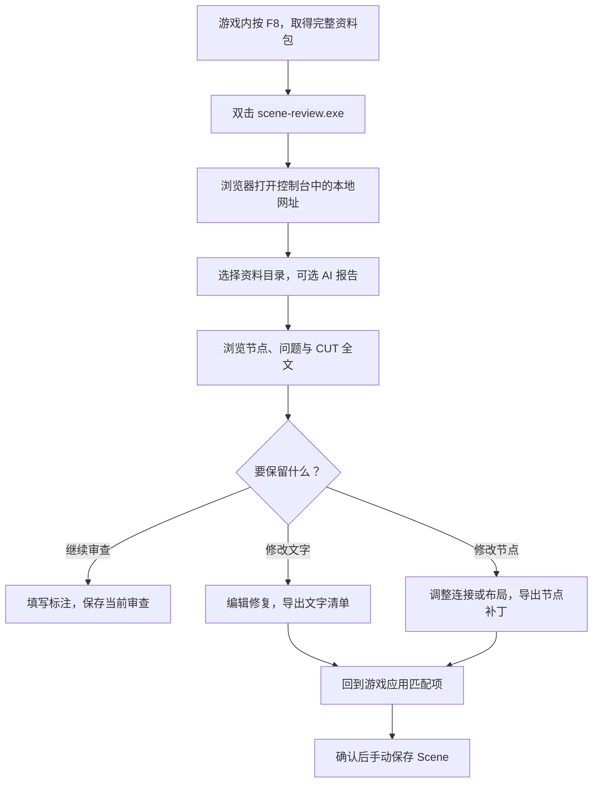
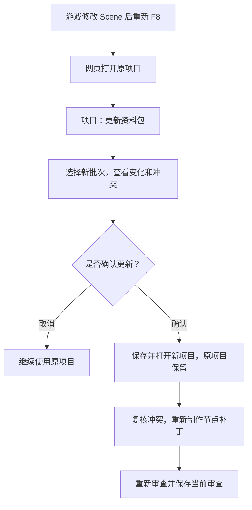

# Scene 审查网页玩家指南

想看清剧情的节点路线、找到报告提到的对白，或者整理一份修改清单？这个网页把游戏里按 F8 导出的 Scene 资料显示成可浏览的节点图，也能保存你的标注、布局和修复草稿。

**网页中的编辑不会直接改游戏。** 文字修复和节点补丁需要导出后，回到游戏应用。

还没有 F8 资料包？先看 [EC_SceneAudit 玩家指南](../readme-gpt-6.1-sol.md#按-f8-导出资料)。

## 第一次使用

1. 双击 **`scene-review.exe`**。
2. 保持弹出的控制台窗口打开，在浏览器访问它显示的网址。默认是 <http://127.0.0.1:18762>。
3. 点击「资料与报告」，选择**直接包含 `bundle.json` 的单个 F8 批次目录**。
4. 如果有 AI 审查报告，再选择对应的 `review-report.json`。如果报告有前版，也可以一起选择。前版可以来自同一 Scene 的旧导出批次。
5. 等待自动检查完成，关闭导入窗口，开始浏览。

只查看资料时，报告可以不选。浏览器选择目录时可能显示「上传」字样，文件仍在本机读取，不会因此发送到网络，也不改动原导出目录。

**只需 `scene-review.exe`，无需安装 Node.js，也无需联网。** 关闭控制台窗口会停止服务。程序会在旁边生成配置和 `data/` 数据目录，请放在允许写入的位置。

## 看节点、问题和对白

### 找到要看的内容

- **点节点**：查看它对应的 Part 和 CUT。Start/End 等系统节点没有对白。
- **点问题**：查看报告说明，并定位到相关位置。有多个位置时逐个选择；空心标记表示共享外部脚本的调用位置，需要选具体调用处。
- **搜索 Part 名称**：大小写和空白不影响搜索。点击候选，或用 ↑ / ↓ 和 Enter 跳转；Esc 关闭候选列表。
- **点 CUT**：打开全文，查看所有文本框和文本布局。CUT 滑条只覆盖当前 Part；到达边界后选择接下来的路线。

多个布局都会显示，网页不会替你判断游戏当前显示哪份，也不会猜测说话人。

### 移动和缩放画布

| 操作 | 方法 |
| --- | --- |
| 选择、框选或移动节点 | 选择工具下使用鼠标左键 |
| 多选节点 | Ctrl 多选，或框选 |
| 平移画布 | 鼠标右键；按 H 切到平移模式后，左右键都能平移 |
| 返回选择工具 | 按 V |
| 缩放 | 鼠标滚轮 |
| 取消正在拖动的操作 | 按 Esc |

输入文字或打开全文、导入窗口时，H/V 不会切换工具。拖动节点只是编辑网页布局；要带回游戏，需导出节点补丁。

### 怎么理解图里的路线

- **普通连线**：来自 F8 的节点连接。标为未启用的出口也可能显示，请看路线文字。
- **脚本跳转**：根据脚本文字分析出的可能路线，不保证实际播放一定经过。
- **草稿跳转**：根据你正在编辑的文字显示的预览。原报告和原始对白仍来自 F8 资料。

动态目标、重名、缺失目标或无效脚本会有提示，网页不会按相似名称猜路线。点击脚本边可以打开来源 CUT，再从文字修复入口修改脚本。

## 保存进度，下次直接继续

推荐第一次加载资料后就打开「项目」，填写项目名，点击**「保存当前审查」**。下次启动网页，从项目列表点击「打开」即可，无需重新选文件。

| 保存方式 | 保存什么 | 适合什么时候用 |
| --- | --- | --- |
| 保存当前审查 | 完整资料、当前及前版报告、标注、布局和修复草稿 | 推荐用于保存完整工作进度；后续修改要再次保存 |
| 登记资料包 | 完整 F8 资料副本，不保存报告 | 只想下次直接打开这份资料；草稿仍按同一批次共用 |
| 保存草稿 | 标注、文字修复、布局、连线等编辑内容 | 暂存编辑；不能代替带报告的项目快照 |

项目和草稿默认写在程序旁的 **`data/`** 目录。换浏览器、换端口或清空浏览器数据，不会删除这些内容。要搬到另一台电脑继续使用，请保留 `data/` 目录；原始 F8 包和报告也建议另外备份。

几个容易混淆的地方：

- **没有保存项目时**，刷新网页后需要重新选择资料和报告。同一批资料已有的已保存草稿可以继续读取。
- **打开已保存项目时**，恢复的是上次保存项目时的草稿快照；要更新快照，再点「保存当前审查」。
- 画布保存按钮是**软盘图标**时，会更新当前项目；是**铅笔图标**时，只保存草稿，不创建项目。
- 删除项目或登记项只删除 `data/` 内的对应副本，原始 F8 目录保持不变。
- 浏览器里的资料是选择时的副本。磁盘文件变了，需要重新选择目录；游戏改了，需要重新 F8。

## 标注剧情，方便自己或 AI 理解

1. 选择节点，打开「编辑与补丁 → 作者标注」。
2. 填写主线/支线、分组、阶段、完成状态和 Part 备注。输入后按回车添加，点击已选项的 × 移除。
3. 同组的说明写在组备注里；仅这个 Part 的说明写在独立备注里。
4. 点击「保存全部编辑」。刷新网页前先保存，避免丢失尚未保存的标注。

一个 Part 可以属于多个分组，阶段只能有一个。Ctrl 多选或框选后可以批量编辑：**只修改勾选字段**；批量设置分组会替换选中节点原有的分组集合。

「审查范围」「标注内容」「已有标注」可以切换查看；切换节点或收起面板不会清空当前编辑。

要交给 AI，使用「导出标注 JSON」和「下载 AI 交接说明」。这两个操作会先保存全部当前编辑。向 AI 提供：

- 原 F8 资料包。
- `author-annotations.json`。
- `author-handoff.md`。
- 插件的整个 `ec-scene-review` 文件夹。

标注表达你想让剧情怎样发展，AI 仍需核对实际脚本。**导入同批次标注会替换当前标注，并恢复文件附带的布局**，建议先导出备份。

## 修改对白或脚本

1. 打开 CUT 全文，在要修改的文本布局旁点击「编辑修复」。
2. 左侧查看原文，在右侧修改整段文字，包括其中的脚本。多个布局需要分别编辑。
3. 查看「前后差异」：红色是原来的行，绿色是修改后的行。
4. 在「编辑与补丁 → 修复清单」检查条目，导出 **`ec-scene-repair-plan.json`**。
5. 按 [游戏内应用步骤](../readme-gpt-6.1-sol.md#应用文字修复) 直接应用，确认后手动保存 Scene。

输入会自动记录并写入数据目录，编辑页也有「保存」按钮。关闭或切换编辑对象会保留有效草稿。存储失败时先导出备份，并处理页面提示。

请留意：

- **清空新文表示把该段改为空文本**。想取消这一项修改，请点「恢复原文」或从清单移除。
- 较长的差异会省略部分行，上方全文和导出文件仍保留完整内容。
- 导入修复清单会**整体替换当前清单**。来源、位置、原文或重复条目有问题时，整份拒绝导入，原草稿保留。
- 缺少原文或定位信息的布局只能阅读；外部脚本文件不能在这里直接编辑。
- 每份清单最多 **1000 项**，每项新文最多 **1,000,000 字符**。

修改文字后，goto 跳转预览会随草稿更新；恢复原文或移除草稿后恢复原始预览。**预览可供检查方向，脚本运行结果仍需在游戏里确认。**

## 修改连线和节点布局

打开「编辑与补丁 → 节点补丁」。顶部「编辑与补丁」按钮可以再次点击收起面板，切页或收起不会丢掉草稿。保存、导出等底栏操作默认隐藏，点击面板顶部的对应按钮展开。

### 改已有连线

- 右键节点或普通连线，搜索并选择新目标。
- 选中节点后，面板列出可用的空出口槽；选择目标即可新建连线。
- 选中普通连线后，也可以拖动目标端点，释放到有效节点上。
- 不能把普通连线改为指向自身，也不能新增或删除节点、选项或输出槽。
- 选项条件、计数和淡入淡出参数保持不变。脚本跳转请通过文字修复修改。

### 整理位置

- 拖动节点，或使用「自动排列」。
- 排列菜单支持对齐、等间隔和吸附；对齐至少选两个节点，等间隔至少选三个。
- 拖动时按 Alt 可以暂时关闭吸附。
- 有完整节点位置和尺寸的 F8 资料时，「恢复游戏布局」可回到导出时的位置。
- 画布下拉菜单可以选择游戏原始大小或 1～10 倍范围。
- 选中普通连线后，拖动绿色路线控制点可以调整网页曲线，**这项调整不会导出到游戏补丁**。

布局、连接、画布和网页路线共用撤销记录，最多 20 条。使用 Ctrl+Z 撤销，Ctrl+Shift+Z 或 Ctrl+Y 重做；输入框内仍使用文字自身的撤销。

| 恢复操作 | 会改变什么 |
| --- | --- |
| 恢复原始连接 | 还原连接，保留节点位置 |
| 恢复游戏布局 | 还原位置，保留连接 |
| 清除全部 | 还原连接和位置，清除网页路线 |

这些操作都会保留当前画布尺寸，并且可以撤销。

### 把补丁带回游戏

检查修改清单后，点击「导出补丁」，再按 [游戏内节点补丁步骤](../readme-gpt-6.1-sol.md#应用节点补丁) 应用。

导入节点补丁时，先查看替换范围，再确认；只含连接的补丁会保留当前位置和画布。旧 F8 资料若没有完整节点位置和尺寸，可以继续阅读、标注、修复文字和编辑连接；要导出精确布局，请在游戏里重新 F8。

扩大游戏画布需要支持动态扩展的 EC_NodeSidePanel。网页选择了大画布，不代表游戏已经扩展；游戏应用时还会检查并要求确认。

## 游戏改过后，更新审查资料

同一 Scene 改完后，先在游戏里重新按 F8。要继续使用旧标注，请用「更新资料包」，不要把旧清单直接套到新批次上。

1. 在网页打开原项目，点击「项目 → 更新资料包」。
2. 选择新的完整 F8 批次目录。
3. 查看匹配、新增、删除、变化和草稿冲突。
4. 确认后保存并打开新项目；原项目保留。取消则维持原视图。

- 能对应到同一节点且类型未变时，保留分组、备注、阶段、状态和网页位置；新增节点使用新包位置。
- 文字、结构或相关连线变化会列为待复核。冲突的文字修复不会进入可应用清单，已经达到目标文字的条目不会重复应用。
- 旧节点补丁保留在待复核记录里。请在新资料中重新制作，不能只改旧补丁的来源继续应用。
- 旧 AI 报告进入历史记录，新包当前报告为空，需要重新审查。
- 在「项目 → 迁移记录」查看旧标注、冲突草稿和历史报告。新包已有项目时不会覆盖它。

## 常见问题

| 遇到的情况 | 怎么处理 |
| --- | --- |
| 打不开网址 | 确认 `scene-review.exe` 的控制台仍在运行，并使用窗口里显示的网址 |
| 提示端口占用 | 关闭程序，修改旁边 `config.json` 中的端口后重启；字段说明见自动生成的 `config.README.txt` |
| 资料包不完整或检查失败 | 选择直接包含 `bundle.json` 的完整批次目录；不要只选 `scene.json` 或日期目录 |
| 报告不能使用 | 确认报告对应当前批次；资料仍可阅读，问题标记会停用。修订版缺少前版时可继续阅读，提供前版后才能核对修订关系 |
| 能看资料，却不能保存编辑 | 根据页面提示检查本地服务和数据目录是否可写；存储不可用时网页会转为只读 |
| 打开登记资料包后没有报告 | 登记不保存报告；要连报告和编辑一起恢复，请保存并打开项目 |
| 升级后找不到旧进度 | 旧版浏览器中的项目和草稿不会自动迁移；重新选择资料包并保存项目，旧资料另行保留 |

**报告检查通过只表示文件来源和引用能对应，报告结论与游戏修复效果还需要你实际确认。**
